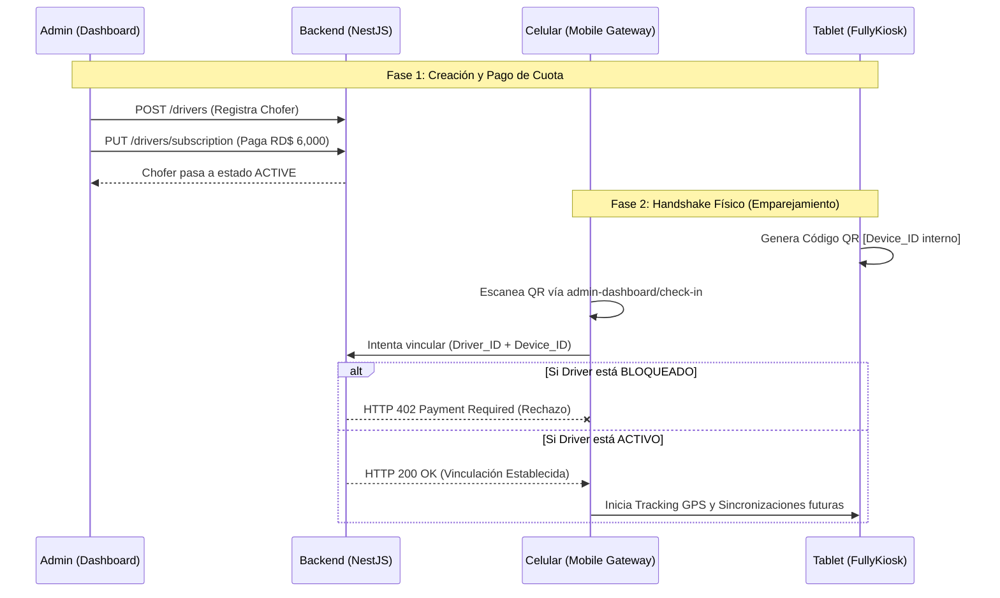
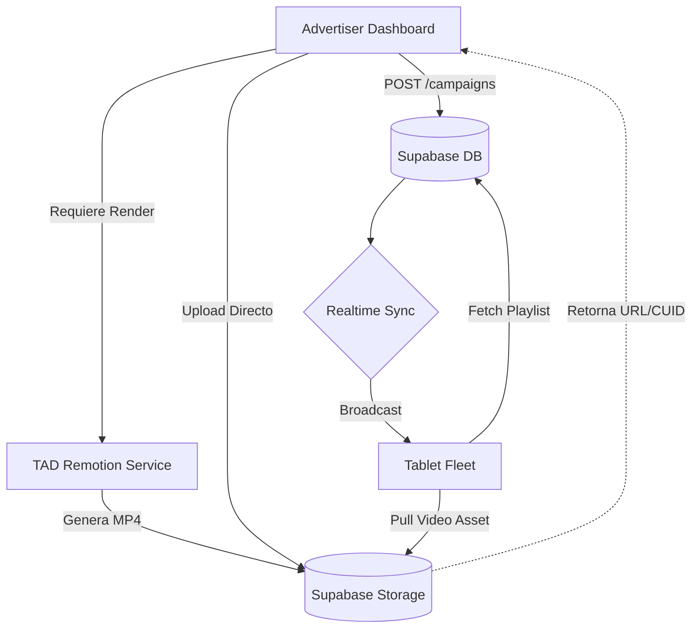
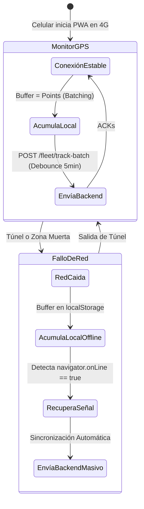
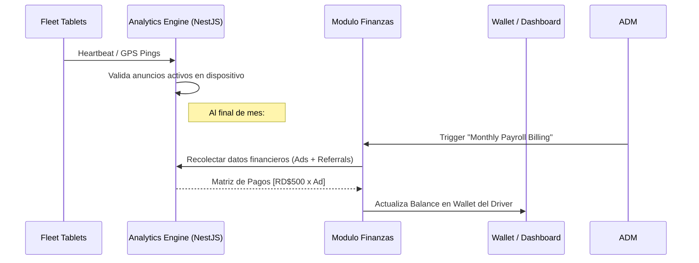

# TAD DOOH Platform: Flujo Operativo Estándar (SOP)

**Versión:** 12.0.0 (Financial & Telemetry V12)
**Última Actualización:** 23 de Abril, 2026

> ⚠️ Creado bajo el escrutinio de resiliencia y monitoreo obsesivo. El ciclo de vida de un anuncio debe ser predecible, determinista y auditable. La versión 12 introduce el ecosistema financiero automatizado y telemetría de bajo impacto.

## 📍 CICLO DE VIDA DEL ANUNCIO Y OPERACIÓN DEL TAXI

El ecosistema se abstrae en fases de alta disponibilidad, desde que ingresamos un conductor al sistema hasta que se emite la factura del anunciante y el pago al conductor.

---

### Fase 1 & 2: Registro Inicial y Emparejamiento de Hardware (Onboarding)

El "Mobile Gateway" (celular del conductor con 4G) da vida a la tablet en el cabezal del asiento. La tablet depende del escaneo QR inicial para autenticarse.

---

### Fase 3: Distribución y Generación (Remotion Microservice)

No subimos blobs de datos pesados por el backend. Además, la generación de videos programáticos se delega a un microservicio dedicado.

---

### Fase 4: Operación en Calle (Offline-First / Telemetría V12)

El conductor viaja y su celular manda coordenadas. Si pierde conexión, hacemos "Batching". El hook `useBackgroundTelemetry` aplica un debounce de 5 min para ahorro de batería.

---

### Fase 5: Cierre Financiero (Wallet V12)

Liquidamos la nómina basados en la presencia de anuncios activos y referidos.

1. **Compensación por Anuncio:** `min(Active_Ads, 15) * RD$500`.
2. **Compensación por Referido:** `RD$500` por cada anunciante cerrado.
3. **ITBIS:** 18% aplicado automáticamente en facturación a marcas.

---

### Fase 6: Ciclo de Referidos (Growth)

Cada conductor actúa como un nodo de venta mediante su código QR único.

1. **Generación:** El Driver genera un QR de referido desde su portal.
2. **Captación:** El potencial anunciante escanea el QR y se registra.
3. **Atribución:** El sistema vincula al anunciante con el `referralCode` del conductor.
4. **Pago:** Tras la primera campaña pagada del anunciante, el conductor recibe su bono en el Wallet.

---

## 🛠️ PARCHES DE SRE ESTABLECIDOS

* [x] **Kill-Switch 402**: Bloqueo automático ante falta de pago de suscripción anual.
* [x] **Background Telemetry**: Debounce de 5 min para preservar batería de dispositivos móviles.
* [x] **Bypass API (PostgREST)**: Telemetría enviada directamente a la base de datos para saltar límites de Vercel/NestJS.
* [x] **CORS & handshake**: Estabilizado vía `x-device-id` whitelist para el handshake entre la app móvil y el gateway de NestJS.
* [ ] **PostGIS & RLS Isolation (spatial_ref_sys)**: PENDIENTE de verificación sobre el proyecto canónico de EasyPanel. El proyecto Supabase conectado el 2026-11-21 tenía PostGIS ausente; no se considera resuelto el error 42501 ni autorizado ningún cambio de propiedad, GRANT o RLS. Incidente P0 #217.

---

### Fase 7: Gobernanza de Base de Datos y RLS (DBA PostGIS SOP)

Protocolo de diagnóstico de solo lectura de Row Level Security (RLS) y PostGIS. La reparación requiere respaldo restaurado y revisión de migración independiente (P0 #217):

1. **Aislamiento de Extensiones**: verificar primero mediante catálogo si PostGIS y `spatial_ref_sys` existen y quién es el propietario; no asumir ownership ni forzar RLS sobre objetos de extensión.
2. **Privilegios de Aplicación**: comprobar permisos efectivos mediante consultas de catálogo; no presumir grants ni modificarlos automáticamente.
3. **Migraciones Revisadas**: no ejecutar DDL ni migraciones sobre la base activa durante el incidente P0; preparar una migración aditiva revisada tras verificar backup/restauración aislada.
4. **Verificación Periódica**: utilizar únicamente el protocolo de diagnóstico de solo lectura de la skill `tad-postgis-rls-resolver`. El ejecutor `apps/api/scripts/dba_remediation.cjs` está retirado y rechaza su ejecución.
