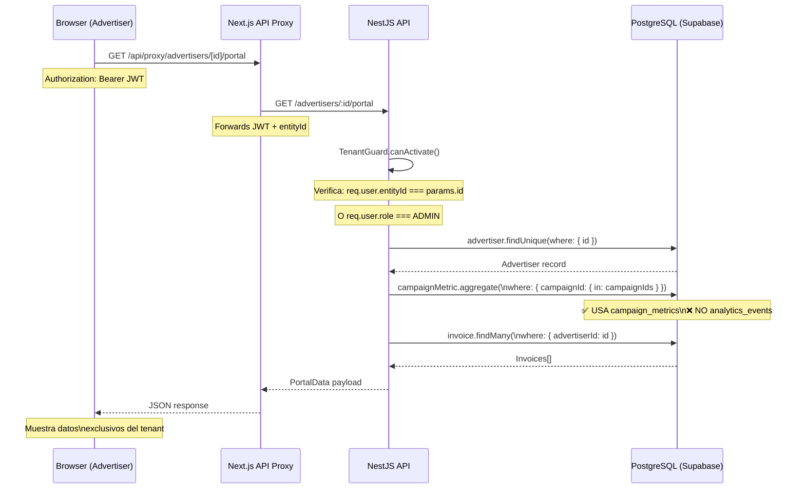

# 📊 11 — FLUJO DE DATOS DEL PORTAL ANUNCIANTE v12

> **Versión**: v12.1.2 — Consolidación SaaS Advertiser
> **Generado**: 2026-05-25
> **Autores**: CTO / Antigravity Architect
> **Stack**: Next.js 15 (Pages Router) · NestJS 10 · Prisma · PostgreSQL (Supabase)

---

## 1. Diagrama de Flujo Completo: Modelo Prepago DOOH

```mermaid
flowchart TD
    A([Anunciante se registra]) --> B[Advertiser creado\nen tabla advertisers\nstatus: ACTIVE]
    B --> C[Login → JWT firmado\ncon app_metadata.entityId = advertiser.id]

    C --> D{¿Quiere publicar?}
    D -->|Sí| E[Crea solicitud en portal\nPOST /portal-requests\ntype: CAMPAIGN_CREATE]

    E --> F[Admin crea Campaign\nen tabla campaigns\nstatus: PENDING_PAYMENT\nactive: true]
    F --> G[Se genera Invoice\nen tabla invoices\nstatus: PENDING\nsubtotal + ITBIS 18%]

    G --> H{UI Bloquea Métricas\nStatus 402 Semántico}
    H -->|Advertiser ve| I[CTA de Pago\nCard bloqueada con\nlock icon + amount]

    I --> J[Pago recibido\nInvoice.status = PAID]
    J --> K[Campaign.status = ACTIVE\nDevices descargan contenido]

    K --> L[PlaybackEvents generados\npor tablets en campo]
    L --> M[Cron nocturno agrega\ndatos en campaign_metrics\ncampaignId + date + city]

    M --> N[API lee campaign_metrics\nPARA TODAS LAS MÉTRICAS\nO1 de RAM garantizado]
    N --> O[Dashboard Advertiser\nmuestra datos reales]

    style H fill:#7C3AED,color:#fff
    style J fill:#059669,color:#fff
    style K fill:#D97706,color:#fff
    style N fill:#1D4ED8,color:#fff
```



---

## 2. Arquitectura de Tenant Isolation



---

## 3. Mapa de Endpoints del API (NestJS)

### Portal de Anunciante (Tenant-Isolated)

| Método | Ruta | Guard | Descripción | Fuente de Datos |
|--------|------|-------|-------------|-----------------|
| `GET` | `/advertisers/:id/portal` | `TenantGuard` | Dashboard principal: KPIs, campañas, métricas | `campaign_metrics` (aggregate) |
| `GET` | `/advertisers/:id/invoices` | `TenantGuard` | Lista de facturas del anunciante | `invoices` |
| `GET` | `/advertisers/:id` | `TenantGuard` | Perfil del anunciante | `advertisers` |
| `PUT` | `/advertisers/:id` | `TenantGuard` | Actualizar perfil | `advertisers` |
| `POST` | `/advertisers/login` | `@Public` + Rate Limit | Autenticación (5/min) | `advertisers` (bcrypt) |
| `GET` | `/campaigns` | `ADVERTISER` role | Campañas propias | `campaigns WHERE advertiserId = entityId` |
| `POST` | `/campaigns/simulate-budget` | `ADVERTISER` role | Simulador de alcance | Cálculo matemático + fleet count |
| `GET` | `/campaigns/reports/summary` | `ADVERTISER` role | BI Reports page | `campaign_metrics` + `analytics_events` (QR only) |
| `POST` | `/portal-requests` | `ADVERTISER` role | Nueva solicitud | `portal_requests` |
| `GET` | `/portal-requests` | `ADVERTISER` role | Mis solicitudes | `portal_requests WHERE advertiserId = entityId` |

### Autenticación JWT

```
JWT Payload:
{
  sub: advertiser.id,
  email: advertiser.email,
  role: "ADVERTISER",
  app_metadata: {
    role: "ADVERTISER",
    entityId: advertiser.id    ← THE TENANT KEY
  }
}
```

---

## 4. Regla de Eficiencia de Recursos: campaign_metrics vs analytics_events

### ❌ PROHIBIDO — Query directa a `analytics_events` para dashboards

```typescript
// JAMÁS hacer esto para KPIs del dashboard:
const impressions = await prisma.analyticsEvent.count({
  where: { campaignId: { in: campaignIds } }
});
// Razón: analytics_events crece EXPONENCIALMENTE (millones de filas)
// En EasyPanel con 2GB RAM: desborda el query planner de Postgres
```

### ✅ CORRECTO — Leer de `campaign_metrics` (tabla de resúmenes)

```typescript
// ✅ USAR SIEMPRE para impresiones y completions en dashboards:
const metricsAgg = await prisma.campaignMetric.aggregate({
  where: { campaignId: { in: campaignIds } },
  _sum: { totalImpressions: true, totalCompletions: true },
});
// Razón: campaign_metrics tiene N filas donde N = campaigns × días × ciudades
// Crecimiento: O(log n) → sostenible en EasyPanel VPS
```

### Excepción Legítima — QR Scans
Los escaneos QR (`qr_scan`) NO se agregan en `campaign_metrics`. Por tanto, la consulta a `analyticsEvent.count({ where: { eventType: 'qr_scan' } })` es la **única excepción aceptada**. Esta tabla es la fuente de verdad para interacciones directas del pasajero.

---

## 5. Flujo de Facturación Prepago (Detalle Técnico)

### Tabla `invoices` — Campos Clave

```prisma
model Invoice {
  id           String     // TAD-INV-xxxxxxxx
  advertiserId String     // FK → advertisers (TENANT KEY)
  issueDate    DateTime   // Fecha de emisión
  dueDate      DateTime   // Fecha límite de pago
  subtotal     Float      // Base sin impuesto
  taxAmount    Float      // ITBIS 18% = subtotal * 0.18
  totalAmount  Float      // subtotal + taxAmount
  status       String     // PENDING | PAID | OVERDUE
  pdfUrl       String?    // Link al PDF de factura (si existe)
}
```

### Cálculo de Balance Pendiente

```typescript
// En el servicio, calcular balanceRD (saldo por pagar):
const pendingInvoices = await prisma.invoice.findMany({
  where: {
    advertiserId: id,
    status: { not: 'PAID' }
  }
});
const balanceRD = pendingInvoices.reduce(
  (acc, inv) => acc + inv.totalAmount, 0
);
```

### Estados Visuales en la UI

| Estado Campaign | Color | Comportamiento UI |
|-----------------|-------|-------------------|
| `PENDING_PAYMENT` | 🟡 Amber | Bloquea métricas, muestra CTA de pago con monto de factura |
| `ACTIVE` | 🟢 Emerald | Muestra métricas en tiempo real desde `campaign_metrics` |
| `PAUSED` | 🔵 Blue | Muestra última métrica conocida + badge "Pausada" |
| `EXPIRED` | ⚫ Zinc | Muestra historial final, botón "Renovar" |

---

## 6. Arquitectura de Skeleton Loaders y Zero States

### Filosofía de UX (Stitched UI)
- **Skeleton**: Siempre imita exactamente la estructura del componente real
- **Zero State**: Nunca mostrar tabla vacía — mostrar CTA accionable
- **Error State**: Toast + botón de retry con exponential backoff

### Árbol de Decisión de Renderizado

```
¿loading === true?
  └─ Mostrar SkeletonCard (animate-pulse)
¿error !== null?
  └─ Mostrar Toast.error + botón "Reintentar"
¿data.length === 0?
  └─ Mostrar ZeroState con CTA
¿data.length > 0?
  └─ Renderizar componente real con datos
```

---

## 7. Notas de Mantenimiento

- **Cron de agregación**: Existe trigger/cron que debe poblar `campaign_metrics` diariamente. Si esta tabla está vacía en producción, los dashboards mostrarán ceros reales (correcto, no mocks).
- **Índices críticos**: `campaign_metrics` tiene índice compuesto `(campaignId, date, city)` — nunca remover.
- **Conexiones Supabase**: Usar siempre el Pooler (puerto 6543) para queries transaccionales desde NestJS en producción.

---

*Documento generado por Antigravity Architect | TAD DOOH Platform v12.1.2*
