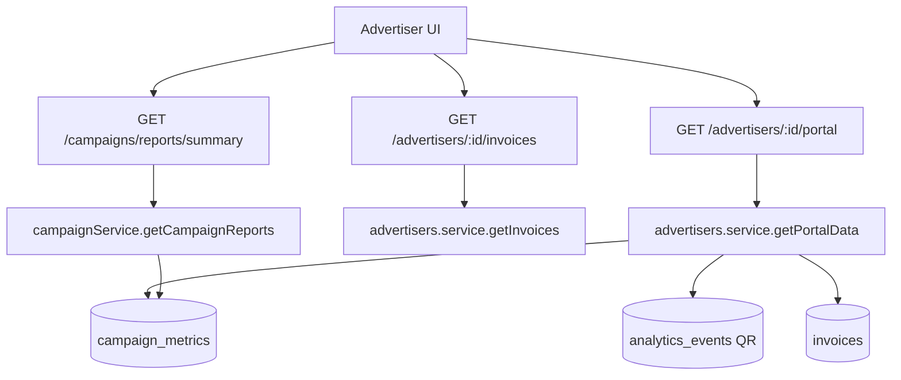

# 11_advertiser_data_flow_v12

## Flujo SaaS Advertiser (Prepago)

## Mapa de Endpoints
- `GET /advertisers/:id/portal`: Resumen integral (brand, stats, financials, campaigns, timeSeries).
- `GET /advertisers/:id/invoices`: Facturación dedicada (invoices, balanceRD, statusSummary).
- `GET /campaigns/reports/summary`: KPIs agregados por advertiser autenticado.

## Justificación técnica
- `campaign_metrics` es la fuente primaria para impresiones/completions por su agregación estable y costo de consulta.
- `analytics_events` se mantiene solo para QR scans al no existir esa métrica en `campaign_metrics`.
- La separación de `/invoices` evita sobrerespuesta del portal y mejora TTFB de billing.
