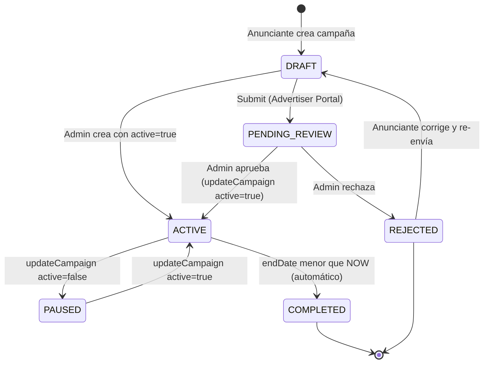
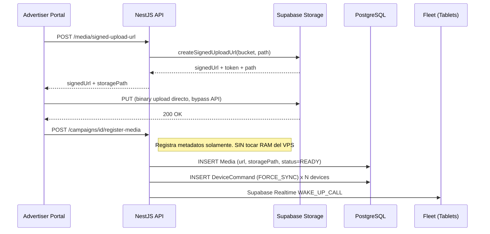
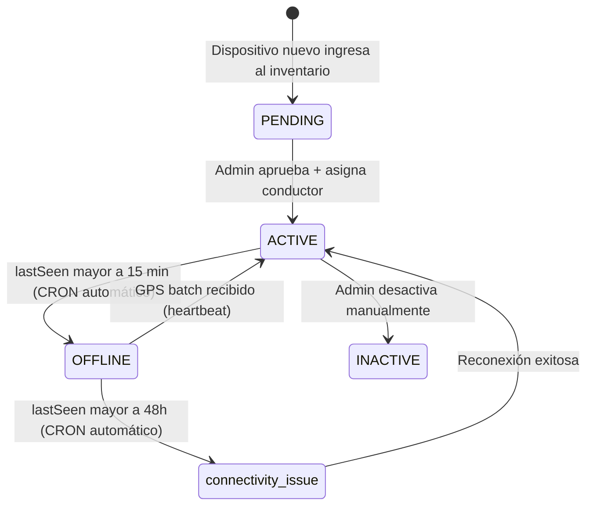
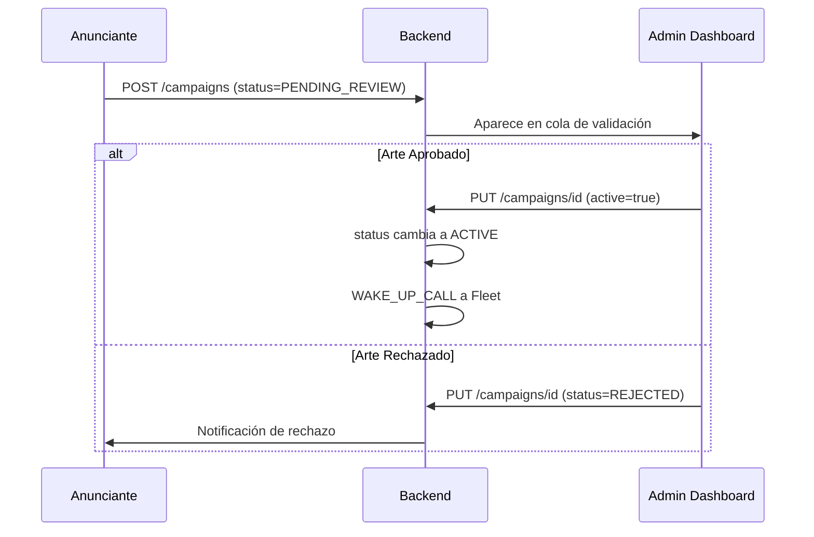

# 📘 TAD DOOH — Documentación Maestra

**Versión:** 10.1.0 (UX & Auth Enhanced)  
**Última Actualización:** 13 de Abril, 2026 (02:35 AM)  
**Propietario:** TAD Dominicana, S.R.L.  
**Stack:** NestJS · Prisma · Supabase · EasyPanel VPS · Next.js 15 · Remotion · Glassmorphic UI

---

## Tabla de Contenido

1. [Módulo de Advertisers (Gestión de Demanda)](#1-módulo-de-advertisers-gestión-de-demanda)
   - [1.1 Flujo de Presupuesto](#11-flujo-de-presupuesto)
   - [1.2 Calculadora de Anuncios y Tiempo (Simulador de Impacto)](#12-calculadora-de-anuncios-y-tiempo-simulador-de-impacto)
   - [1.3 Métricas y Alcance (KPIs)](#13-métricas-y-alcance-kpis)
   - [1.4 Estados de Campaña](#14-estados-de-campaña)
   - [1.5 Actualización de Contenido (Media Pipeline)](#15-actualización-de-contenido-media-pipeline)
2. [Módulo de Admin/Ops (Supervisión y Escalabilidad)](#2-módulo-de-adminops-supervisión-y-escalabilidad)
   - [2.0 Experiencia de Usuario - Admin Node](#20-experiencia-de-usuario---admin-node)
   - [2.1 Gestión de Inventario de Hardware](#21-gestión-de-inventario-de-hardware)
   - [2.2 Auditoría Financiera](#22-auditoría-financiera)
   - [2.3 Control de Requerimientos Masivos](#23-control-de-requerimientos-masivos)
   - [2.4 Acciones por Servicio (Panel Admin)](#24-acciones-por-servicio-panel-admin)
3. [Diccionario de Acciones por Servicio (Lógica Interna)](#3-diccionario-de-acciones-por-servicio-lógica-interna)
   - [3.1 Matriz de Acciones — Conductores (Driver)](#31-matriz-de-acciones--conductores-driver)
   - [3.2 Matriz de Acciones — Anunciantes (Advertiser)](#32-matriz-de-acciones--anunciantes-advertiser)
   - [3.3 Matriz de Acciones — Campañas y Contenido](#33-matriz-de-acciones--campañas-y-contenido)
   - [3.4 Matriz de Acciones — Flota y Monitoreo](#34-matriz-de-acciones--flota-y-monitoreo)
4. [Guía Maestra de Usuario (Knowledge Base / FAQ)](#4-guía-maestra-de-usuario-knowledge-base--faq)
   - [4.1 Preguntas Frecuentes — Conductores (Drivers)](#41-preguntas-frecuentes--conductores-drivers)
   - [4.2 Preguntas Frecuentes — Anunciantes (Advertisers)](#42-preguntas-frecuentes--anunciantes-advertisers)
   - [4.3 Preguntas Frecuentes — Operaciones (Ops / Admin)](#43-preguntas-frecuentes--operaciones-ops--admin)
5. [Apéndice: Constantes de Negocio](#5-apéndice-constantes-de-negocio)

---

## 1. Módulo de Advertisers (Gestión de Demanda)

## 1.1 Flujo de Presupuesto

El ciclo de capital de un anunciante opera con un modelo de **facturación por bloque de 30 segundos**, no por impresiones puras (CPM clásico). El precio es determinista, no dinámico.

### Lógica de Carga de Créditos

| Paso | Acción | Servicio | Resultado en DB |
| :--- | :--- | :--- | :--- |
| 1 | Anunciante crea campaña con `budget` | `CampaignService.createCampaign()` | `Campaign.budget = X` RD$ |
| 2 | Sistema calcula pantallas recomendadas | `CampaignService.simulateImpact()` | No persiste — solo estimación |
| 3 | Admin aprueba arte/campaña | `CampaignService.updateCampaign()` | `Campaign.status = 'ACTIVE'` |
| 4 | Facturación al final del periodo | `FinanceService.getCampaignBillingReport()` | `FinancialTransaction` con ITBIS 18% |

### Consumo en Tiempo Real

El consumo NO se debita en tiempo real del presupuesto cargado. TAD opera con **facturación post-consumo**:

1. El anunciante define un presupuesto objetivo (`budget` en RD$).
2. El sistema auto-asigna pantallas según el presupuesto: `Math.floor(budget / 3000)` pantallas o un mínimo de 10.
3. Al final de mes, `FinanceService` genera la factura real basada en:
   - Número de Media Assets × bloques de 30s × `RD$1,500` por bloque × meses activos.
   - ITBIS 18% añadido automáticamente.

### Gestión de Acceso (UX Premium)

El Portal de Anunciantes ha sido actualizado con una **Multi-Vista Glassmorphic** que consolida el acceso:

- **Registro Público**: Los nuevos anunciantes pueden crear su cuenta directamente (`POST /advertisers`). El backend realiza el hashing automático de la contraseña.
- **Recuperación**: Flujo integrado conectado a `/advertisers/recover-password`.
- **Interfaz**: Soporte para mostrar/ocultar contraseña y micro-interacciones de validación.

### Alertas de Presupuesto Bajo

> [!IMPORTANT]
> **Regla Financiera:** El costo base por campaña publicitaria es de **RD$1,500 por bloque de 30 segundos por mes** (`ADVERTISER_COST_PER_CAMPAIGN_RD`). El ITBIS del 18% se aplica automáticamente sobre el subtotal.

Actualmente, el sistema **no envía alertas automáticas** cuando el presupuesto proyectado es insuficiente. El anunciante puede verificar su posición financiera visitando el Portal (`getPortalData()`) que retorna:

```json
{
  "financials": {
    "subtotal": 4500,
    "taxAmount": 810,
    "totalCost": 5310,
    "costPerAd": 1500,
    "taxRate": 0.18
  }
}
```

---

## 1.2 Calculadora de Anuncios y Tiempo (Simulador de Impacto)

El endpoint `CampaignService.simulateImpact(budgetRD, city)` permite al anunciante estimar el alcance antes de comprometerse.

### Algoritmo del Simulador

```text
CPM Referencia    = RD$1,500 por pantalla/mes (bloque 30s)
Personas/Pantalla = 1,500 - 2,000 alcanzadas/mes (Alcance Único)
Factores de Multiplicación:
  - Frecuencia: ~2 visualizaciones por pasajero por viaje.
  - Densidad: 2-3 pasajeros promedio por viaje.

Entrada: budget (RD$), city (string)

1. onlineScreensCount = COUNT(Device WHERE city=X AND status='ACTIVE' AND connectivity='ONLINE')
2. recommendedScreens = MIN(onlineScreensCount, FLOOR(budget / 1500))
3. totalImpressions   = recommendedScreens × 2,000 (Personas) × 2 (Frecuencia)

Salida: { budget, city, recommendedScreens, totalImpressions, uniqueReach }
```

### Ejemplo Práctico

| Presupuesto | Ciudad | Pantallas | Personas Alcanzadas | Impresiones Totales (~2x) |
| :--- | :--- | :--- | :--- | :--- |
| RD$15,000 | Santiago | 8 | 16,000 | 32,000 |
| RD$6,000 | Santo Domingo | 4 | 8,000 | 16,000 |
| RD$50,000 | Global | 33 | 66,000 | 132,000 |

---

## 1.3 Métricas y Alcance (KPIs)

Los KPIs se alimentan de múltiples tablas y se consolidan en el endpoint `AdvertisersService.getPortalData()`:

| KPI | Fuente de Datos | Cálculo |
| :--- | :--- | :--- |
| **Impresiones Totales** | `CampaignMetric.totalImpressions` | `SUM(totalImpressions)` agrupadas por `campaignId` |
| **Completions** | `CampaignMetric.totalCompletions` | `SUM(totalCompletions)` — video visto completamente |
| **QR Scans** | `AnalyticsEvent` WHERE `eventType IN ('qr_scan', 'scan_redirect', 'scan', 'QR_SCAN')` | `COUNT(*)` por campaña |
| **Alcance Geográfico** | `CampaignMetric.city` | Agrupación por ciudad |
| **Time Series** | `CampaignMetric` agrupado por `date` | Últimos 7 días, `SUM` diaria |
| **Sync Progress** | `DeviceCampaign` + `Device.lastSyncAt` vs `Campaign.updatedAt` | `(syncedDevices / totalAssigned) × 100%` |

### Definición de "Horas Pico"

El sistema registra timestamps en `AnalyticsEvent` y `PlaybackEvent`. Las horas pico se derivan filtrando por hora del día:

- **Mañana Pico:** 7:00-9:00 AM
- **Tarde Pico:** 5:00-7:00 PM 
- Estas ventanas corresponden a congestión vehicular en Santo Domingo y Santiago.

---

## 1.4 Estados de Campaña



| Estado | `status` en DB | `active` flag | Descripción |
| :--- | :--- | :--- | :--- |
| **Borrador** | `DRAFT` | `false` | Campaña creada pero no enviada |
| **Pendiente de Revisión** | `PENDING_REVIEW` | `false` | Enviada por anunciante, requiere aprobación de arte |
| **Activa** | `ACTIVE` | `true` | En rotación en tablets, generando impresiones |
| **Pausada** | `ACTIVE` | `false` | Temporalmente retirada de rotación |
| **Finalizada** | `COMPLETED` | `false` | Período de campaña expirado |
| **Rechazada** | `REJECTED` | `false` | Arte no cumple requisitos |

> [!WARNING]
> **Transición Crítica:** Cuando una campaña pasa a `ACTIVE`, el sistema automáticamente:
> 1. Refresca la vista `ActiveCampaignsView` en PostgreSQL.
> 2. Emite un `WAKE_UP_CALL` vía Supabase Realtime al canal `fleet_sync`.
> 3. Crea comandos `FORCE_SYNC` para todos los dispositivos asignados (o todos los activos si `targetAll=true`).

---

## 1.5 Actualización de Contenido (Media Pipeline)

### Flujo de Subida Segura



> [!IMPORTANT]
> **Regla de Seguridad (Anti-OOM):** El contenido multimedia **NUNCA** pasa por el backend. El Portal solicita una URL firmada de Supabase Storage y sube directamente. Solo los metadatos se registran en el API.

### Validaciones de Contenido

| Regla | Valor | Servicio |
| :--- | :--- | :--- |
| Formato aceptado | `video/mp4` (H.264) | `CampaignService.registerDirectMedia()` |
| Tamaño máximo | **55 MB** (`57,671,680 bytes`) | `BUSINESS_RULES.MAX_VIDEO_SIZE_BYTES` |
| Slots máximos por tablet | **15 campañas** simultáneas | `BUSINESS_RULES.MAX_CAMPAIGNS_PER_DRIVER` |

---

## 2. Módulo de Admin/Ops (Supervisión y Escalabilidad)

## 2.0 Experiencia de Usuario - Admin Node

El panel administrativo utiliza una estética **"High-Security Industrial Terminal"** con:
- Capas de desenfoque profundo (`backdrop-blur-xl`).
- Animaciones de pulso para estados críticos.
- Acceso restringido estrictamente a roles `ADMIN`.
- Soporte de recuperación de cuenta orientado a soporte interno.

## 2.1 Gestión de Inventario de Hardware

### Trazabilidad de Tablets por ID

Cada dispositivo se rastrea por dos identificadores:
- **UUID** (`Device.id`): Identificador interno de PostgreSQL.
- **Hardware ID** (`Device.deviceId`): Formato `STI####` para el piloto Santiago o `TAD-XXXXXXXX` para registros automáticos.

| Campo | Tipo | Descripción |
| :--- | :--- | :--- |
| `deviceId` | `string` | ID de hardware (ej: `STI0001`) |
| `taxiNumber` | `string` | Placa/número del taxi |
| `status` | `enum` | `ACTIVE`, `INACTIVE`, `OFFLINE`, `PENDING` |
| `connectivityStatus` | `string` | `ONLINE`, `connectivity_issue` |
| `driverId` | `FK -> Driver` | Conductor asignado |
| `lastSeen` | `DateTime` | Último heartbeat |
| `lastLat` / `lastLng` | `Float` | Última coordenada GPS |
| `batteryLevel` | `Int` | Nivel de batería (%) |
| `appVersion` | `string` | Versión del Player instalado |

### Estados Físicos del Hardware



### Registro de Deuda Técnica (Hardware)

> [!CAUTION]
> **Regla Financiera — Membresía Anual:** Cada conductor debe abonar **RD$6,000** (`STARTER_KIT_ANNUAL_FEE_RD`) como cuota anual por el Starter Kit (tablet). Este monto también cubre la **responsabilidad civil** por daño o pérdida del equipo. Si el conductor no paga, el sistema ejecuta el protocolo **Kill-Switch** (HTTP 402).

| Concepto | Monto | Frecuencia | Servicio Responsable |
| :--- | :--- | :--- | :--- |
| Starter Kit (Tablet) | RD$6,000 | Anual | `FinanceService.notifyMorosidad()` |
| Responsabilidad Civil | RD$6,000 | Por daño/pérdida | Manual (Admin) |
| ITBIS incluido | 18% | Sobre cuota | `FinanceService.recordTransaction()` |

---

## 2.2 Auditoría Financiera

### Conciliación: Anunciantes vs. Conductores

La auditoría se ejecuta conciliando dos flujos:

**Flujo INCOMING (Cobro a Anunciantes):**

```text
SubtotalFactura = SUM(MediaAssets x bloques30s x RD$1,500 x mesesActivos)
ITBIS           = SubtotalFactura x 0.18
TotalFactura    = SubtotalFactura + ITBIS
```

**Flujo OUTGOING (Pago a Conductores):**

```text
IngresoAds      = CampañasActivas x RD$500
BonoGPS         = (gpsPoints >= 100) ? RD$500 : RD$0
BonoReferidos   = referidosConductores x RD$500 + referidosAnunciantes x RD$500
TotalNómina     = IngresoAds + BonoGPS + BonoReferidos - Penalizaciones
```

**Fee de TAD (Margen Operativo):**

```text
MargenTAD = TotalFacturadoAnunciantes - TotalNóminaConductores - ITBIS - OPEX
```

> [!IMPORTANT]
> **Verificación con `FinanceService.getFinancialSummary()`:**
> - **MRR** = `COUNT(Driver WHERE ACTIVE AND subscriptionPaid) x RD$6,000`
> - **Burn Rate** = `SUM(FinancialTransaction WHERE type='OUTGOING' AND month=current)`
> - **Net Projection** = MRR - Burn Rate

### Tabla `FinancialTransaction` — Categorías

| Categoría | Tipo | Descripción |
| :--- | :--- | :--- |
| `SUSCRIPCION` | `INCOMING` | Pago de membresía anual RD$6,000 |
| `PUBLICIDAD` | `INCOMING` | Facturación de campaña a anunciante |
| `REVENUE_AD` | `INCOMING` | Ingreso neto por pauta publicitaria |
| `REVENUE_SUBSCRIPTION` | `INCOMING` | Ingreso neto por suscripciones |
| `OPEX_DRIVER_PAYOUT` | `OUTGOING` | Pago de nómina a conductores |
| `OPEX_COMMISSION` | `OUTGOING` | Comisiones y bonos |
| `OPEX_MARKETING` | `OUTGOING` | Gastos de adquisición de clientes |

---

## 2.3 Control de Requerimientos Masivos

### Sistema de Colas y Estados

#### A) Nuevos Registros de Conductores

| Paso | Estado `Driver.status` | `onboardingStatus` | Acción Requerida |
| :--- | :--- | :--- | :--- |
| 1 | `PENDING_PAYMENT` | `TOS_PENDING` | Conductor se registra y acepta contrato + seguro |
| 2 | `PENDING_PAYMENT` | `PENDING_PAYMENT` | Admin verifica pago de RD$6,000 |
| 3 | `ACTIVE` | `READY` | Conductor habilitado para operar |
| 4 | `SUSPENDED` | — | Admin bloquea por morosidad |

> [!IMPORTANT]
> **Saneamiento de Registros:** El backend limpia automáticamente cédulas y placas para evitar errores de duplicidad silenciosos durante el registro.

#### B) Retiros de Billetera (Payouts)

1. Admin ejecuta `FinanceService.triggerMonthlyBilling(month, year)`.
2. Sistema verifica si la nómina del periodo ya fue procesada (**idempotencia**).
3. Calcula nómina para todos los conductores con `calculateMonthlyPayroll()`.
4. Crea registros `PayrollPayment` con `status: 'PENDING'` para montos mayor a 0.
5. Admin procesa pagos individuales vía `processPayment()` con `status: 'PAID'`.
6. Export CSV masivo disponible vía `exportPayrollCsv()`.

#### C) Validación de Artes de Campaña



---

## 2.4 Acciones por Servicio (Panel Admin)

### SubscriptionGuard — Control de Suscripciones

| Acción Admin | Servicio | Método | Efecto |
| :--- | :--- | :--- | :--- |
| Forzar bloqueo manual | `DriversService` | `updateSubscription(id, false)` | `status=SUSPENDED`, `blockedAt=NOW()` |
| Desbloquear conductor | `DriversService` | `updateSubscription(id, true, endDate)` | `status=ACTIVE`, `subscriptionPaid=true` |
| Detectar morosos CRON | `FinanceService` | `checkHighDelinquency()` | Escaneo diario a las 3AM, genera facturas y notifica vía WhatsApp |

### FinanceService — Ajustes Manuales

| Acción Admin | Método | Parámetros Clave |
| :--- | :--- | :--- |
| Registrar transacción manual | `recordTransaction()` | `{ type, category, amount, entityId, note }` |
| Ajustar comisión | `recordTransaction({ category: 'OPEX_COMMISSION' })` | Registra OUTGOING con nota explicativa |
| Bono manual | `recordTransaction({ category: 'OPEX_DRIVER_PAYOUT' })` | Abono directo al conductor |
| Generar factura HTML | `generateInvoiceHtml(campaignId)` | Retorna HTML con diseño premium TAD |

### CRM — Auditoría de Logs

| Dato Auditable | Tabla | Campo Clave |
| :--- | :--- | :--- |
| Última actividad conductor | `Driver.updatedAt` | Timestamp auto-actualizado |
| Último heartbeat tablet | `Device.lastSeen` | Actualizado por GPS batch |
| Log de impresiones | `PlaybackEvent` | `deviceId`, `videoId`, `eventType`, `timestamp` |
| Trail GPS completo | `DriverLocation` | `driverId`, `latitude`, `longitude`, `speed`, `timestamp` |
| Transacciones financieras | `FinancialTransaction` | `type`, `category`, `amount`, `entityId`, `createdAt` |

---

## 3. Diccionario de Acciones por Servicio (Lógica Interna)

## 3.1 Matriz de Acciones — Conductores (Driver)

| Usuario Hace | Servicio Ejecuta | Resultado en DB |
| :--- | :--- | :--- |
| Driver crea cuenta (App) | `DriversService.create()` | `INSERT Driver` con registro de password hasheado y limpieza de IDs |
| Driver acepta contrato | `DriversService.acceptAgreement()` | `UPDATE Driver SET contractAccepted=true` + Aceptación de seguro de equipo |
| Driver inicia sesión | `DriversService.login()` | Valida bcrypt, firma JWT, optimizado para touch (teclado `tel`) |
| Admin paga suscripción | `DriversService.updateSubscription(id, true)` | `UPDATE Driver SET subscriptionPaid=true, status=ACTIVE` |
| Admin asigna tablet | `DriversService.assignDevice()` | `UPDATE Device SET driverId=X` (desvincula anterior) |
| Driver envía GPS batch | `MonitoringService.processGpsBatch()` | `INSERT DriverLocation (N registros)` + `UPDATE Device (lastLat, lastLng, isOnline=true, status=ACTIVE)` |
| Driver envía GPS batch (vía Fleet) | `FleetService.trackBatch()` | Valida suscripción, `INSERT DriverLocation` + actualiza `Device`. Si no pagó: `HTTP 402` |
| Driver consulta su hub | `DriversService.getDriverHubDataById()` | 5 queries paralelas (ads, GPS, pagos), retorna payload de dashboard |
| Admin calcula nómina | `FinanceService.calculateMonthlyPayroll()` | `groupBy DriverLocation` + campañas activas x RD$500 + bonos |
| CRON detecta morosidad (3AM) | `FinanceService.checkHighDelinquency()` | Busca `subscriptionPaid=false AND subscriptionEnd < NOW()`, WhatsApp + ledger |
| CRON detecta offline (30min) | `MonitoringService.checkOfflineDevices()` | `UPDATE Device SET isOnline=false, status=OFFLINE` + WhatsApp al admin si es piloto STI |

## 3.2 Matriz de Acciones — Anunciantes (Advertiser)

| Usuario Hace | Servicio Ejecuta | Resultado en DB |
| :--- | :--- | :--- |
| Anunciante se registra | `AdvertisersService.create()` | `INSERT Advertiser` con password hasheado (Flujo Público) |
| Anunciante inicia sesión | `AdvertisersService.login()` | Valida bcrypt, JWT `role=ADVERTISER, entityId=advertiser.id` |
| Anunciante crea campaña | `CampaignService.createCampaign()` | `INSERT Campaign (status=PENDING_REVIEW)` + auto-asignación de dispositivos por ciudad |
| Anunciante sube video | Portal, Signed URL, Supabase Storage | Solo metadatos en `Media` table |
| Anunciante registra media | `CampaignService.registerDirectMedia()` | `INSERT Media (status=READY)` |
| Anunciante consulta dashboard | `AdvertisersService.getPortalData()` | Agregaciones de métricas, scans, sync progress |
| Anunciante simula presupuesto | `CampaignService.simulateImpact()` | Query `Device.count`, cálculo in-memory (no persiste) |
| Anunciante recupera contraseña | `AdvertisersService.recoverPassword()` | Genera JWT de reset + email de confirmación (confirmado visualmente) |
| Anunciante establece nueva pass | `AdvertisersService.resetPassword()` | `UPDATE Advertiser SET password=hashed` tras validación de token |

## 3.3 Matriz de Acciones — Campañas y Contenido

| Usuario Hace | Servicio Ejecuta | Resultado en DB |
| :--- | :--- | :--- |
| Admin aprueba campaña | `CampaignService.updateCampaign(id, { active: true })` | `UPDATE Campaign SET active=true, status=ACTIVE` + `WAKE_UP_CALL` Realtime |
| Admin asigna devices a campaña | `CampaignService.assignCampaignToDevices()` | `DELETE old PlaylistItem/DeviceCampaign`, `INSERT new`, `FORCE_SYNC` commands |
| Admin vincula media a campaña | `CampaignService.linkMediaToCampaign()` | `UPDATE Media SET campaign_id=X` + `FORCE_SYNC` + `WAKE_UP_CALL` |
| Tablet solicita playlist | `CampaignService.getActiveSyncVideos(deviceId)` | Query híbrida: Global + Geofencing + Manual (v1/v2), respeta límite 15 slots |
| Admin agrega media asset | `CampaignService.addMediaAsset()` | `INSERT MediaAsset` + `FORCE_SYNC` a todos los devices |

## 3.4 Matriz de Acciones — Flota y Monitoreo

| Usuario Hace | Servicio Ejecuta | Resultado en DB |
| :--- | :--- | :--- |
| Admin abre mapa en vivo | `FleetService.getFleetMap()` | Query todos los `Device` con coords, estado online (30min threshold) |
| Admin solicita tracking summary | `FleetService.getTrackingSummary()` | Join `Driver + Device + DriverLocation` con groupBy GPS |
| Admin envía comando broadcast | `FleetService.broadcastCommand(type)` | Supabase Realtime `WAKE_UP_CALL` + `INSERT DeviceCommand x N devices` (48h TTL) |
| Admin registra taxi nuevo | `FleetService.registerDeviceByAdmin()` | Upsert `Device + Driver` con lógica de vinculación inteligente |
| Admin consulta ruta reciente | `FleetService.getDeviceRecentPath(deviceId)` | `SELECT TOP 60 DriverLocation ORDER BY timestamp DESC` |
| CRON marca connectivity_issue | `MonitoringService.checkOfflineDevices()` | `UPDATE Device SET connectivityStatus='connectivity_issue'` WHERE `lastSeen mas de 48h` |

---

## 4. Guía Maestra de Usuario (Knowledge Base / FAQ)

## 4.1 Preguntas Frecuentes — Conductores (Drivers)

### "¿Por qué no veo saldo en mi dashboard?"

**Posibles Causas:**
1. **Suscripción no pagada:** Tu cuenta muestra `subscriptionPaid: false`. Contacta al administrador para registrar el pago de RD$6,000.
2. **Sin campañas asignadas:** Si tu tablet no tiene campañas activas, el ingreso proyectado será RD$0. Las campañas se asignan por ciudad y disponibilidad.
3. **Penalización activa:** Si acumulaste meses bajo la meta de transmisión, el `PayrollAuditService` aplica un descuento del 10% al nivel BASE (120h).
4. **Período sin liquidar:** La nómina se calcula mensualmente. Si el admin no ha ejecutado `triggerMonthlyBilling()` para este mes, no verás pagos recientes.

**Solución:** Verifica tu hub (`/drivers/me/hub`) — revisa los campos `subscriptionPaid`, `activeAds` y `penaltyApplied`.

---

### "¿Cómo retiro mi dinero?"

El flujo de retiro es:
1. El administrador genera la nómina del mes con `triggerMonthlyBilling(month, year)`.
2. Tu registro aparece en `PayrollPayment` con `status: 'PENDING'`.
3. El admin procesa el pago y actualiza a `status: 'PAID'`.
4. Recibirás una notificación cuando el desembolso se complete.

**Tu ingreso se calcula así:**

| Concepto | Monto |
| :--- | :--- |
| Por cada anuncio activo en tu tablet | **RD$500/mes** |
| Bono de disponibilidad GPS (100 o mas pings/mes) | **RD$500** |
| Por cada conductor activo referido | **RD$500** |
| Por cada anunciante referido | **RD$500** |
| Techo máximo de ads (15 slots) | **RD$7,500** |

---

### "¿Qué pasa si mi tablet se rompe o la pierdo?"

> [!CAUTION]
> **Responsabilidad Civil:** El conductor asume responsabilidad por **RD$6,000** por daño o pérdida del equipo según el contrato firmado y el seguro aceptado en el onboarding (App v2.0).

**Proceso:**
1. Reporta inmediatamente al administrador vía WhatsApp.
2. El admin desvincula la tablet: `DriversService.unlinkDevice(driverId)`.
3. Se genera una transacción de cargo: `FinanceService.recordTransaction({ type: 'INCOMING', category: 'SUSCRIPCION', amount: 6000 })`.
4. Una vez liquidada la deuda, se asigna un equipo de reemplazo.

---

### "¿Por qué mi tablet dice 'Suscripción Pendiente'?"

Si la tablet muestra la pantalla de bloqueo, tu suscripción está vencida o no fue registrada:
- **Kill-Switch automático:** Cuando `subscriptionPaid = false` y `subscriptionEnd < NOW()`, el sistema responde `HTTP 402 Payment Required` a los pings GPS.
- **La PWA del conductor destruye** el Worker GPS y muestra una advertencia visual.
- **Solución:** Contacta al admin para registrar el pago y ejecutar `updateSubscription(id, true, newEndDate)`.

---

## 4.2 Preguntas Frecuentes — Anunciantes (Advertisers)

### "¿Cómo mejoro mi alcance?"

1. **Aumenta tu presupuesto:** Usa el simulador (`simulateImpact`) para estimar cuántas pantallas puedes alcanzar por cada RD$1,500 adicionales.
2. **Elige `targetAll: true`:** Tu campaña se distribuirá a TODAS las tablets activas de la flota, no solo a las de tu ciudad.
3. **Selecciona `targetCity: 'Global'`:** Elimina la restricción geográfica.
4. **Optimiza la duración del video:** Cada bloque de 30 segundos cuenta como una unidad de facturación. Un video de 15s cuesta lo mismo que uno de 30s.
5. **Incluye QR Code:** Agrega URL con tracking para medir conversiones reales (campo `targetUrl`).

---

### "¿Por qué mi anuncio está en revisión?"

Cuando creas una campaña desde el Portal de Anunciantes (no como Admin), el sistema la crea con `status: 'PENDING_REVIEW'`. Esto permite que el equipo de TAD valide:

**Tiempo estimado de revisión:** 24-48 horas hábiles. Una vez aprobado, recibirás el `WAKE_UP_CALL` que sincroniza tu contenido con la flota.

| Validación | Criterio |
| :--- | :--- |
| Formato de video | `video/mp4` con encoding H.264 |
| Tamaño del archivo | 55 MB o menos |
| Contenido apropiado | Revisión manual por el equipo |
| Información de marca | Campos `advertiser`, `category` completos |

**Tiempo estimado de revisión:** 24-48 horas hábiles. Una vez aprobado, recibirás el `WAKE_UP_CALL` que sincroniza tu contenido con la flota.

---

### "¿Cómo veo las métricas de mi campaña?"

Accede al **Portal de Anunciantes** (`/dashboard`). Tu vista incluye:
- **Summary:** Impresiones totales, completions, QR scans.
- **Campaigns:** Lista detallada con sync progress por dispositivo.
- **Time Series:** Gráfico de impresiones diarias (últimos 7 días).
- **Financial:** Subtotal, ITBIS, costo total por período.

Para reportes detallados, contacta al equipo TAD para exportar CSV vía `exportCampaignCsv(campaignId)`.

---

## 4.3 Preguntas Frecuentes — Operaciones (Ops / Admin)

### "¿Cómo procesar 100 pagos de nómina en un click?"

```text
Endpoint: POST /finance/billing/trigger
Body:     { "month": 4, "year": 2026 }
Servicio: FinanceService.triggerMonthlyBilling()
```

**Proceso interno:**
1. Verifica idempotencia: si ya existe `PayrollPayment` para este periodo, aborta.
2. Ejecuta `calculateMonthlyPayroll()` para todos los conductores.
3. Pre-calcula GPS counts con `groupBy driverLocation` (una sola query).
4. Procesa conductores con `throttledMap(concurrency=5)` para no saturar el pool de Prisma.
5. Crea registros `PayrollPayment` solo para montos mayores a 0.
6. Retorna `{ success: true, count: N }`.

> [!TIP]
> **Performance:** La optimización `groupBy` en lugar de N+1 queries redujo el tiempo de cálculo de nómina de 30+ segundos a ~3 segundos para 100 conductores.

**Export masivo:** `GET /finance/payroll/export?month=4&year=2026` retorna CSV con todas las columnas de nómina.

---

### "¿Cómo auditar una discrepancia de GPS?"

**Herramientas disponibles:**

| Herramienta | Endpoint | Alcance |
| :--- | :--- | :--- |
| Trail de dispositivo | `GET /fleet/devices/{deviceId}/recent-path` | Últimos 60 puntos GPS |
| Tracking completo | `GET /fleet/tracking` | Últimas 500 ubicaciones con driver info |
| Resumen por conductor | `GET /fleet/tracking/summary` | GPS points hoy, promedio velocidad, estado activo |
| Mapa en vivo | `GET /fleet/map` | Todas las tablets con coordenadas y estado online |
| Piloto Santiago | `GET /monitoring/pilot` | Solo dispositivos STI0001-STI0010 |

**Proceso de auditoría paso a paso:**
1. Identifica el `driverId` y `deviceId` del conductor en cuestión.
2. Consulta `getDeviceRecentPath(deviceId)` para ver si hay huecos en el trail.
3. Compara `Device.lastSeen` con el último registro en `DriverLocation`.
4. Si hay discrepancia mayor a 48h, verifica `Device.connectivityStatus` — si es `connectivity_issue`, el conductor puede no tener cobertura.
5. Cruza con `PayrollPayment` para asegurar que los GPS points del período corresponden al pago procesado.

---

### "¿Cómo forzar una sincronización en toda la flota?"

```text
Endpoint: POST /fleet/broadcast-command
Body:     { "type": "FORCE_SYNC", "params": { "reason": "admin_manual" } }
Servicio: FleetService.broadcastCommand()
```

Esto ejecuta:
1. **Supabase Realtime** envía `WAKE_UP_CALL` en canal `fleet_sync` (efecto inmediato en dispositivos conectados).
2. **DeviceCommand** con `INSERT` y `status=PENDING` con TTL de 48h para dispositivos offline.

---

### "¿Cómo registrar un nuevo taxi rápidamente?"

```text
Endpoint: POST /fleet/register
Body:     { "placa": "A-123456", "nombreChofer": "Juan Pérez", "deviceId": "STI0011" }
Servicio: FleetService.registerDeviceByAdmin()
```

El sistema aplica **lógica de upsert inteligente:**
1. Si el `deviceId` ya existe: actualiza datos del conductor vinculado.
2. Si el conductor ya existe (por teléfono): vincula al nuevo dispositivo.
3. Si ambos son nuevos: crea `Device + Driver` en una transacción.

---

## 5. Apéndice: Constantes de Negocio

> [!NOTE]
> **Fuente de verdad:** Todas estas constantes están centralizadas en [business-rules.ts](file:///c:/Users/Arismendy/OneDrive/Escritorio/TAD%20PLASTFORM/tad-dooh-platform/apps/api/src/common/constants/business-rules.ts). Modificar aquí afecta automáticamente todos los servicios.

## Tarifas y Montos (RD$)

| Constante | Valor | Descripción |
| :--- | :--- | :--- |
| `DRIVER_RATE_PER_CAMPAIGN_RD` | **500** | Ingreso mensual del conductor por cada campaña activa |
| `DRIVER_REFERRAL_BONUS_RD` | **500** | Comisión por cada conductor activo referido |
| `ADVERTISER_REFERRAL_BONUS_RD` | **500** | Comisión por cada anunciante referido |
| `STARTER_KIT_ANNUAL_FEE_RD` | **6,000** | Cuota anual de membresía/hardware |
| `ADVERTISER_COST_PER_CAMPAIGN_RD` | **1,500** | Costo por bloque de 30s por mes para anunciantes |
| `ITBIS_RATE` | **0.18** | Tasa de impuesto ITBIS (18%) |

## Límites Operativos

| Constante | Valor | Descripción |
| :--- | :--- | :--- |
| `MAX_CAMPAIGNS_PER_DRIVER` | **15** | Máximo de campañas simultáneas por tablet |
| `MAX_VIDEO_SIZE_MB` | **55** | Tamaño máximo de archivo multimedia |
| `MAX_VIDEO_SIZE_BYTES` | **57,671,680** | Equivalente en bytes |

## Configuración de Seguridad

| Constante | Valor | Descripción |
| :--- | :--- | :--- |
| `JWT_EXPIRY` | **7d** | Duración del token de sesión |
| `BCRYPT_ROUNDS` | **10** | Rondas de hash para todas las contraseñas |
| `CONTRACT_VERSION` | **2.0** | Versión actual (Contrato + Seguro Hardware) |
| `PUBLIC_ROUTES` | `Bypass` | Corrección de RolesGuard para acceso público (Login/Register) |

## Niveles de Desempeño del Conductor

| Nivel | Horas Requeridas | Prioridad de Asignación | Penalización |
| :--- | :--- | :--- | :--- |
| **ORO** | 200h/mes | 3 (máxima) | 0% |
| **PLATA** | 160h/mes | 2 | 0% |
| **BASE** | 120h/mes | 1 (mínima) | 10% descuento en nómina |

## CRONs Automáticos del Sistema

| CRON | Frecuencia | Servicio | Acción |
| :--- | :--- | :--- | :--- |
| Detección Morosidad | Diario @ 3:00 AM | `FinanceService.checkHighDelinquency()` | Escaneo de drivers morosos. WhatsApp + ledger |
| Detección Offline | Cada 30 min | `MonitoringService.checkOfflineDevices()` | Marca offline (15min). connectivity_issue (48h). Push 12h. WhatsApp piloto |

---

> **TAD Dominicana, S.R.L.** — *Plataforma v10.0.0 (Microservices Architecture)*  
> *Documento generado el 13 de Abril, 2026*
