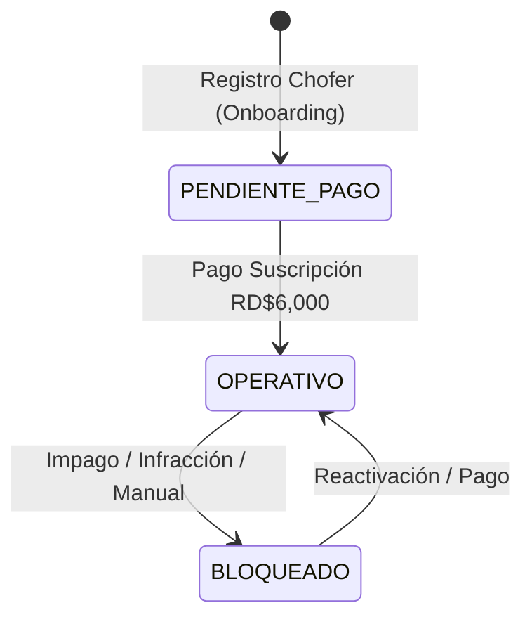

# 🚗 TAD DOOH PLATFORM — PLAN MAESTRO Y ESTRATÉGICO 2026

**Versión**: 12.5.0 (Estrategia Maestra de Escala, Experiencia de Usuario y Control Operativo)
**Fecha de Consolidación**: Octubre 2026
**Ámbito**: Monorepo TAD DOOH (`apps/admin`, `apps/advertiser`, `apps/driver`, `apps/player`, `apps/api`)
**Propósito**: Establecer la guía maestra e interactiva para optimizar la experiencia de usuario (UX/DX), la trazabilidad de procesos y la capacidad estructural para escalar de manera segura a **+10,000 conductores (taxistas)** y **+1,000 anunciantes activos**.

---

## 🧭 1. RESUMEN EJECUTIVO Y VISIÓN DE PLATAFORMA

La plataforma **TAD DOOH (Taxi Advertising Distribution)** es una red de publicidad Digital-Out-Of-Home en vehículos de transporte público y privado en República Dominicana. Combina hardware embarcado (tablets Android), pasarelas móviles (teléfono móvil del conductor), motores de renderizado de video programático (Remotion), asistentes con inteligencia artificial (Meta/WhatsApp Bot) y un backoffice central con gestión financiera, logística y de rendimiento en tiempo real.

### 🎯 Objetivos Estratégicos de Escala (Escala 10k/1k)
1. **Capacidad de Concurrencia**: Sostener **10,000+ pantallas simultáneas** reportando telemetría GPS, latidos de corazón (*heartbeats*) y reproducciones offline sin saturar la base de datos ni degradar la experiencia.
2. **Integridad Financiera Fricción Cero**: Garantizar pagos exactos a taxistas (RD$500/mes por anuncio activo, bonos de referido) y cobro a anunciantes (RD$1,500/mes por pantalla) mediante transacciones atómicas, idempotencia estricta y auditorías automáticas.
3. **Optimización de Portales e Interacciones**: Eliminar pasos manuales y cuellos de botella mediante flujos guiados (onboarding en < 3 minutos, creación de campañas programáticas en < 2 minutos).
4. **Resiliencia Operativa 99.9% Offline**: Operación autónoma en tablets con sincronización diaria por lotes (*batch sync*) y resistencia a pérdidas prolongadas de señal 4G.
5. **Gobernanza y Transparencia en Tiempo Real**: Dashboards interactivos, control preciso por estados (FSM - Finite State Machines) y documentación interactiva para consulta inmediata de cualquier rol.

---

## 👥 2. MATRIZ MAESTRA DE USUARIOS, ROLES Y PORTALES

| Rol de Usuario | Portal / Aplicación | Dispositivo Principal | Objetivo Principal | Nivel de Permisos / RLS |
| :--- | :--- | :--- | :--- | :--- |
| **Administrador / Operador** | `apps/admin` | Desktop / Laptop | Supervisión global, aprobación de campañas, gestión de choferes, pagos de nómina y BI. | Role `ADMIN` (Superuser operacional / Full Access vía API). |
| **Anunciante / Marca** | `apps/advertiser` | Desktop / Tablet / Móvil | Crear campañas, subir contenidos/videos, elegir ciudades/flotas, pagar y medir ROI. | Role `ADVERTISER` (RLS aislado a sus campañas y métricas). |
| **Conductor / Taxista** | `apps/driver` | Smartphone (Android/iOS) | Registro, vinculación con tablet, cobro de comisiones, consulta de billetera y estado. | Role `DRIVER` (RLS aislado a sus dispositivos, balance y comisiones). |
| **Dispositivo Tablet (Pasajero)** | `apps/player` | Tablet 10" (FullyKiosk) | Reproducción fluida de video, captura de impresiones y geolocalización. | Auth Token Dispositivo (`DEVICE_TOKEN` / Anon + Device ID). |
| **Operador de Flota** | `apps/admin` (Vista Flota) | Desktop / Tablet | Monitoreo de su flota asignada, ingresos colectivos y rendimiento por taxi. | Role `FLEET_MANAGER` (Aislado por `fleet_id`). |
| **Agente IA / Asistente Virtual** | `apps/api` (WhatsApp/Social) | WhatsApp / Instagram | Calificación de leads, onboarding guiado, preguntas frecuentes y alertas. | Service Role / Bot API Key. |

---

## 📐 3. ARQUITECTURA DE EXPERIENCIA E INTERACCIONES POR PORTAL

### 🏢 3.1. PORTAL ADMINISTRADOR (`apps/admin`)

#### A. Módulos e Interacciones Clave
1. **Control Central de Choferes y Dispositivos**:
   - *Acciones*: Alta de taxistas, asignación de vehículo, pago/verificación de suscripción anual (RD$6,000), bloqueo/desbloqueo (*Kill-Switch*).
   - *Optimización UX*: Búsqueda instantánea con filtros combinados (Estado: `OPERATIVO`, `PENDIENTE_PAGO`, `BLOQUEADO`; Ciudad; Flota). Expansión de fila con 1-clic para ver hardware, nivel de batería, última sincronización y mapa GPS.

2. **Aprobación de Campañas y Moderación de Medios**:
   - *Acciones*: Revisión de videos subidos por anunciantes, validación de formato (1080x1920 vertical, H.264, max 30s), aprobación o rechazo con motivo justificado, asignación de dispositivos target.
   - *Optimización UX*: Reproductor de video en modal con overlay de zona segura para tablets, botón de aprobación masiva con 1-clic que dispara generación en Remotion.

3. **Ecosistema Financiero y Nómina (Lote Mensual)**:
   - *Acciones*: Generación de borradores de nómina (*Settlement Batches*), revisión de discrepancias en *Reconciliation Reports*, aprobación de pagos a billeteras de choferes.
   - *Optimización UX*: Indicadores visuales de salud financiera (Verde: OK; Amarillo: Discrepancia menor; Rojo: Conflicto de transmisión/reproducción).

4. **Monitor de Mapa en Tiempo Real (MAP-SPEC-2026)**:
   - *Acciones*: Mapa interactivo con clusters de taxis, orientación según rumbo GPS, filtro online/offline (Debounce 5 min).

#### B. Matriz de Estados de Proceso (FSM Chofer/Dispositivo)


---

### 📢 3.2. PORTAL DEL ANUNCIANTE (`apps/advertiser`)

#### A. Módulos e Interacciones Clave
1. **Creación Asistida de Campañas (Wizard 4 Pasos)**:
   - *Paso 1 (Detalles)*: Nombre de marca, categoría, fechas de inicio y fin.
   - *Paso 2 (Targeting)*: Selección de ciudades (`target_cities` en JSONB), flotas específicas (`target_fleets`), horario/días permitidos.
   - *Paso 3 (Carga Creativa / IA)*: Subida de MP4 o creación asistida vía motor Remotion (plantillas dinámicas). Generación de QR interactivo para captar leads en cabina.
   - *Paso 4 (Presupuesto y Pago)*: Cálculo dinámico de pantallas objetivo (Regla de 15 slots max por taxi), generación de `PaymentIntent` y pasarela de pago / evidencia.

2. **Dashboard de Rendimiento e Impacto (ROI)**:
   - *Acciones*: Visualización de impresiones totales, reproducciones completadas (100% completion rate), mapas de calor (*heatmaps*) de cobertura vehicular.
   - *Optimización UX*: Métricas exportables en PDF/CSV con certificación de auditoría para agencias de publicidad.

3. **Portal de Interacción con Pasajeros (Leads por QR)**:
   - *Acciones*: Registro de escaneos de QR emitidos en la pantalla, tasa de conversión e integración con conversaciones de WhatsApp.

---

### 🚖 3.3. APP / PORTAL DEL CONDUCTOR (`apps/driver`)

#### A. Módulos e Interacciones Clave
1. **Onboarding Express & Contrato Digital**:
   - *Acciones*: Registro con teléfono, aceptación de acuerdo legal y póliza de seguro en 1-clic, subida de foto de vehículo/cédula.
   - *Optimización UX*: Interfaz responsive estilo nativo (Tailwind 4) optimizada para smartphones con uso a una sola mano.

2. **Handshake Físico y Sincronización de Tablet**:
   - *Acciones*: Escaneo del código QR presentado por la tablet en el taxi para vincular `driver_id` <-> `device_id`.
   - *Mecanismo de Seguridad*: Rechazo automático HTTP 402 si el conductor está en estado `BLOQUEADO` o `PENDIENTE_PAGO`.

3. **Billetera Digital y Retiros**:
   - *Acciones*: Ver saldo disponible (RD$500/mes por anuncio activo + RD$500 por referido convertido), historial de transacciones, solicitud de retiro a cuenta bancaria.
   - *Garantía Financiera*: Idempotencia garantizada en solicitudes de pago (header `x-idempotency-key`).

---

### 📺 3.4. TABLET PLAYER DOOH (`apps/player`)

#### A. Módulos e Interacciones Clave
1. **Arranque y Autenticación Autónoma**:
   - *Acciones*: Encendido mediante FullyKiosk / Android Service, lectura de `auth_token` local, presentación de QR de emparejamiento si es nuevo.

2. **Descarga y Reproducción Contigua (Offline-First)**:
   - *Acciones*: Petición de sincronización de playlist (`/api/v1/devices/:id/sync`). Descarga diferida de MP4 a almacenamiento interno. Reproducción continua sin tirones en loop secuencial.

3. **Telemetría y Registro de Eventos**:
   - *Acciones*: Almacenamiento local (IndexedDB / SQLite) de eventos de playback (`PLAY_START`, `PLAY_COMPLETE`, `ERROR`) y coordenadas GPS.
   - *Envío Eficiente*: Sincronización por lotes (*batch telemetry*) cuando recupera cobertura 4G, reduciendo consumo de batería y datos móviles.

---

### 🤖 3.5. AGENTE IA & ASISTENTE VIRTUAL (`apps/api` - Social & WhatsApp)

#### A. Módulos e Interacciones Clave
1. **Atención a Taxistas y Anunciantes por WhatsApp**:
   - *Acciones*: Calificación de leads, recepción de comprobantes de pago de suscripción, guía de instalación de tablet.
2. **Generación Automática de Contenido Social**:
   - *Acciones*: Creación de borrador de publicaciones para promocionar marcas asociadas (`social_post_drafts`) con revisión humana (`human_review_tasks`).

---

## 📊 4. MATRIZ DE CONTROL DE PROCESOS Y REGLAS DE NEGOCIO CRÍTICAS

| Proceso | Regla de Negocio / Invariante | Solución Técnica en Código | SLA / Límite Esperado |
| :--- | :--- | :--- | :--- |
| **Asignación de Campañas** | Máximo **15 campañas activas** por taxi / dispositivo. | `pg_advisory_xact_lock` + `$transaction` en `CampaignService`. | Lock atómico < 50ms. Sin sobreventa. |
| **Procesamiento Financiero** | Idempotencia estricta en retiros y pagos. Sin duplicaciones. | `IdempotencyInterceptor` + tabla `idempotency_keys` + `SELECT FOR UPDATE`. | 100% libre de doble pago. |
| **Suscripción Conductor** | RD$6,000/año para habilitar operación. | Check en middleware de sync y onboarding `subscription_paid = true`. | Bloqueo inmediato al vencer `due_date`. |
| **Pago a Chofer por Anuncio** | RD$500/mes por cada anuncio activo transmitido. | Calculado en `PayrollAuditService` cruzando `playback_events` y `active_ads`. | Cierre mensual día 1 de cada mes. |
| **Bono de Referidos** | RD$500 para el referente tras validación de primer pago. | Registro en `commissions` + `referral_attributions` con prevención de auto-referido. | Procesamiento atómico en conversión. |
| **Ingreso de Telemetría GPS** | Anti-SQL Injection & Debounce de batería (5 min). | Consultas parametrizadas en `TelemetryService` + actualización `last_lat`/`last_lng`. | < 100ms respuesta API. |

---

## 🚀 5. ARQUITECTURA PARA ESCALA (+10,000 TAXIS / +1,000 ANUNCIANTES)

Para escalar a 10,000 taxis activos emitiendo pings constantes y 1,000 anunciantes consultando métricas, la infraestructura está diseñada bajo patrones de alto rendimiento:

```text
                                 ┌────────────────────────┐
                                 │   Cdn / Edge Gateway   │
                                 └───────────┬────────────┘
                                             │
                       ┌─────────────────────┴─────────────────────┐
                       ▼                                           ▼
             ┌───────────────────┐                       ┌───────────────────┐
             │ Next.js Portals   │                       │ NestJS API v12    │
             │ (Admin/Adv/Driver)│                       │ (Stateless Core)  │
             └───────────────────┘                       └─────────┬─────────┘
                                                                   │
                                             ┌─────────────────────┼─────────────────────┐
                                             ▼                     ▼                     ▼
                                     ┌───────────────┐     ┌───────────────┐     ┌───────────────┐
                                     │ Supabase PG17 │     │ Storage S3    │     │ Remotion Engine│
                                     │ (Connection   │     │ (Videos MP4/  │     │ (Microservicio│
                                     │  Pooler)      │     │  Cdn Assets)  │     │  Video)       │
                                     └───────────────┘     └───────────────┘     └───────────────┘
```

### 🛠️ Estrategias de Escalabilidad de Base de Datos y Caché
1. **Vistas Materializadas para Métricas BI**:
   - Vistas `mv_mrr_summary`, `mv_fleet_health`, y `mv_campaign_performance` para responder a dashboards ejecutivos en < 20ms sin saturar la tabla transaccional `analytics_events`.
   - Cron Job de refresco concurrente: `REFRESH MATERIALIZED VIEW CONCURRENTLY`.

2. **Indexación Estratégica**:
   - Índices GIN en campos JSONB (`target_cities`, `target_fleets`, `bank_account`, `metadata`).
   - Índices B-Tree compuestos en `(device_id, timestamp)` y `(campaign_id, date)` para telemetría.

3. **Pooler de Conexiones (Supavisor / PgBouncer)**:
   - Uso de puerto de transacciones (`6543`) para la API NestJS y puerto de sesión (`5432`) únicamente para migraciones Prisma.

---

## 🔒 6. GOBERNANZA, SEGURIDAD Y CUMPLIMIENTO (SEGURIDAD Y RLS)

### 🛡️ Auditoría de Seguridad y RLS en Supabase
Durante la auditoría de seguridad realizada sobre el proyecto Supabase `ltdcdhqixvbpdcitthqf`, se identifica la siguiente observación crítica de gobernanza de base de datos:

> ⚠️ **AVISO DE SEGURIDAD (Supabase Security Advisor)**:
> La tabla `public.spatial_ref_sys` (creada por la extensión PostGIS) tiene Row Level Security (RLS) desactivado por defecto (`rls_enabled: false`).
> - **Riesgo**: Exposición de metadatos espaciales sobre la API Data REST.
> - **Remediación**: Ejecutar la consulta SQL de remediación para habilitar RLS y restringir acceso de escritura:
>   `ALTER TABLE "public"."spatial_ref_sys" ENABLE ROW LEVEL SECURITY;`
> - **Nota de Seguridad**: Se debe aplicar la política de lectura pública para `anon` y `authenticated` si la aplicación requiere consultas de proyección cartográfica.

### 📜 Políticas de Acceso RLS por Entidad Core
1. **Choferes (`drivers`) / Billeteras (`wallets`)**:
   - `SELECT`, `UPDATE` restringidos estrictamente al propietario mediante `auth.uid() = driver_id`.
2. **Campañas (`campaigns`) / Métricas (`campaign_metrics`)**:
   - `ADVERTISER` solo puede ver y editar sus propias campañas (`advertiser_id = auth.uid()`).
3. **Eventos de Playback (`playback_events`) & Telemetría (`telemetry`)**:
   - Inserción permitida con token válido de dispositivo; lectura pública deshabilitada.

---

## 📋 7. PLAN DE IMPLEMENTACIÓN Y MATRIZ DE ACCIONES POR PORTAL

Para asegurar la ejecución óptima y mejora continua de cada portal, se establece la siguiente matriz de acciones priorizadas:

### 1. Portal Administrador (`apps/admin`)
- [ ] **Acción ADM-1**: Implementar filtro y vista rápida de auditoría de nómina con exportación en formato bancario (ACH / Pagos masivos en lote).
- [ ] **Acción ADM-2**: Incorporar centro de alertas en vivo para detectar tablets sin reportar en > 24 horas y enviar notificación preventiva al chofer vía WhatsApp.
- [ ] **Acción ADM-3**: Habilitar panel de aprobación en 1-clic para comprobantes de pago de suscripción con visión previa del recibo.

### 2. Portal Anunciante (`apps/advertiser`)
- [ ] **Acción ADV-1**: Perfeccionar el Wizard de Campañas añadiendo vista previa en tiempo real de cómo lucirá el anuncio en la tablet (Mockup 3D interactivo).
- [ ] **Acción ADV-2**: Incluir estimador en tiempo real de alcance e impresiones proyectadas según el presupuesto y ciudades seleccionadas.
- [ ] **Acción ADV-3**: Reportes automatizados en PDF enviados semanalmente por correo electrónico al anunciante.

### 3. Portal / App Conductor (`apps/driver`)
- [ ] **Acción DRV-1**: Simplificar la pantalla principal con resumen de ganancias del mes, saldo disponible y botón destacado de "Retirar Fondos".
- [ ] **Acción DRV-2**: Sistema de notificaciones Push / WhatsApp sobre el estado de la batería de su tablet y salud del sistema en su vehículo.
- [ ] **Acción DRV-3**: Flujo interactivo de referidos con código QR personalizable para compartir por WhatsApp.

### 4. Player Tablet (`apps/player`)
- [ ] **Acción PLY-1**: Optimización de caché local de video con rotación inteligente basada en espacio disponible (`storage_free`).
- [ ] **Acción PLY-2**: Auto-diagnóstico de pantalla y conectividad con reinicio silencioso en horas no operativas (ej. 3:00 AM).

---

## 🛟 8. PROTOCOLO DE AUDITORÍA Y VERIFICACIÓN PRE-DESPLIEGUE

Cada cambio en la plataforma debe superar el siguiente check de calidad de 5 pasos:

```text
┌────────────────────────────────────────────────────────────────────────┐
│              PROTOCOLO DE VERIFICACIÓN PRE-DESPLIEGUE (QA)             │
├────────────────────────────────────────────────────────────────────────┤
│ 1. Compilación TypeScript limpia: pnpm --filter <workspace> exec tsc   │
│ 2. Validación de Esquema Prisma: npx prisma validate                   │
│ 3. Pruebas Unitarias / Integración: pnpm --filter api test             │
│ 4. Verificación de Transacciones y Locks: Revisión $transaction        │
│ 5. Control de Calidad RLS y Seguridad: Consulta de Advisors Supabase   │
└────────────────────────────────────────────────────────────────────────┘
```

---

## 🏆 CONCLUSIÓN Y ESTADO DEL PLAN MAESTRO

Este **Plan Maestro y Estratégico 2026** consolida la hoja de ruta operativa, técnica y de experiencia de usuario para la plataforma TAD DOOH. Con esta estructura, el proyecto cuenta con la capacidad de arquitectura, control de procesos e integridad financiera para soportar el crecimiento sostenido a **miles de taxis y anunciantes en toda la República Dominicana**.
