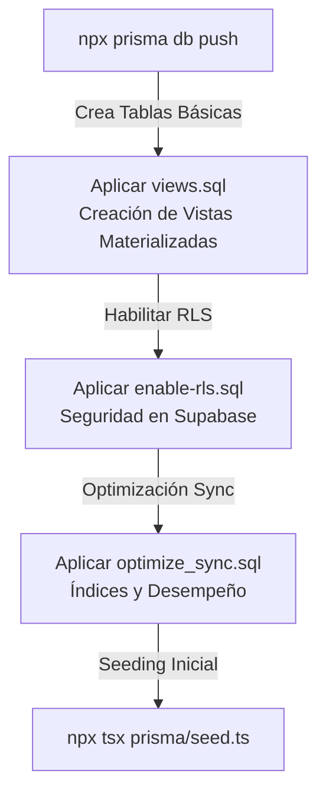

# 🗄️ Base de Datos, Vistas Materializadas y Migraciones

Este documento detalla el procedimiento para inicializar, migrar y mantener la base de datos de TAD DOOH (PostgreSQL + Prisma), incluyendo la aplicación manual de vistas SQL y políticas RLS.

---

## 🏛️ 1. Flujo de Inicialización de la Base de Datos

Prisma ORM gestiona la estructura básica de tablas, pero los componentes avanzados de rendimiento (como índices avanzados y vistas materializadas) y de seguridad (como políticas RLS de Supabase) deben aplicarse ejecutando scripts SQL crudos.



---

## 📊 2. Vistas Materializadas (SRE Performance)

Para asegurar que las peticiones frecuentes de las tablets (`/sync` y heartbeats) no realicen joins complejos que saturen la CPU, el sistema utiliza la vista materializada `mv_active_campaigns` definida en `apps/api/prisma/views.sql`.

### Aplicación Manual de Vistas
Si se destruye o recrea la base de datos, ejecuta el script `views.sql` directamente en tu cliente de base de datos (o mediante el panel de SQL de Supabase):

```sql
-- apps/api/prisma/views.sql
CREATE MATERIALIZED VIEW IF NOT EXISTS mv_active_campaigns AS ...
CREATE UNIQUE INDEX IF NOT EXISTS idx_mv_campaign_id ON mv_active_campaigns (campaign_id);
```

### Refresco de la Vista (Materialized View Refresh)
El backend refresca esta vista de forma automática cada vez que se activa o edita una campaña:

```typescript
// Refresco concurrente sin bloquear lecturas gracias al índice único
await prisma.$executeRaw`REFRESH MATERIALIZED VIEW CONCURRENTLY mv_active_campaigns;`;
```

---

## 🛡️ 3. Seguridad de Datos (Row Level Security - RLS)

Supabase requiere la activación de RLS para evitar que peticiones anónimas lean o modifiquen datos confidenciales de la tabla `analytics_events`. El script `enable-rls.sql` automatiza este proceso:

```sql
ALTER TABLE "analytics_events" ENABLE ROW LEVEL SECURITY;
```

---

## 🧪 4. Datos de Prueba y Simulación (Seeding)

Existen dos scripts en `apps/api/prisma/` para poblar la base de datos dependiendo de la fase de pruebas:

### A) Semilla Limpia de Desarrollo (`seed.ts`)
Pobla la base de datos con la estructura de configuración necesaria y un usuario administrador inicial.
* **Comando:**
  ```bash
  npx tsx apps/api/prisma/seed.ts
  ```
* **Credenciales generadas:**
  * **Admin:** `admin@tadtaxi.do` | `TadAdmin2026!`
  * **Advertiser:** `marketing1@brand.do` | `Tad2026!`
  * **Driver:** `8295550000` | `TadDriver2026!`

### B) Generación de Telemetría Virtual (`simulate-data.ts`)
Genera historial ficticio de reproducciones, coordenadas GPS y logs para probar los gráficos y mapas de calor (Heatmaps) en el Dashboard de Anunciantes y Administradores.
* **Comando:**
  ```bash
  npx tsx apps/api/prisma/simulate-data.ts
  ```
* **Nota de SRE:** Los registros creados por este script se marcan con la bandera `isSimulated: true`. Esto permite purgarlos quirúrgicamente mediante la ruta `/api/v1/simulation/purge` sin alterar la contabilidad real de la plataforma.
