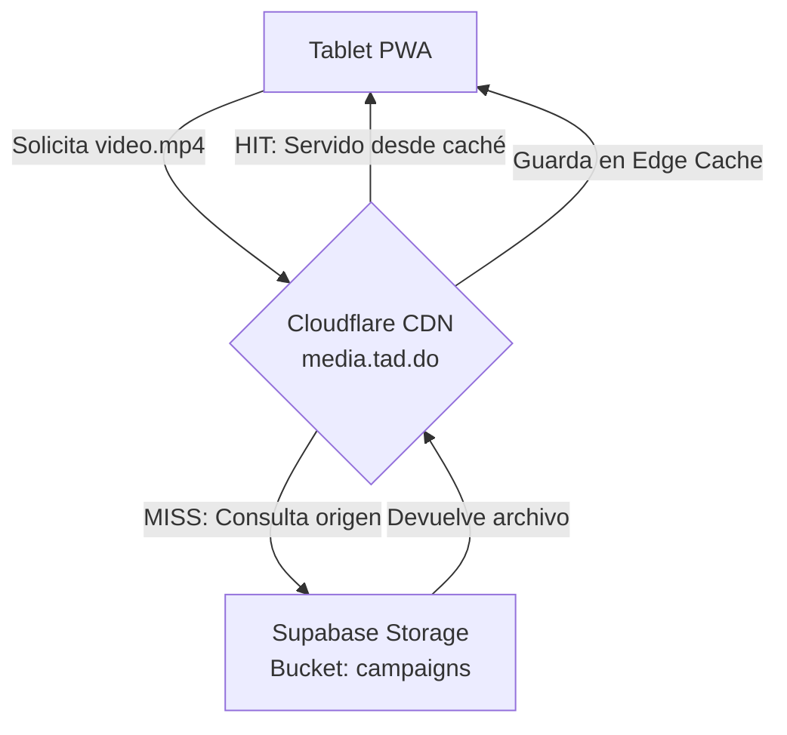

# ☁️ Integración y Caché con Cloudflare CDN (Optimización de Ancho de Banda)

Este documento describe la configuración necesaria en Cloudflare para establecer un CDN frente al almacenamiento de Supabase (`media.tad.do`), mitigando la cuota de **5GB mensuales** del plan gratuito y garantizando una entrega de video de baja latencia a la flota de tablets.

---

## 🏛️ 1. Flujo de Datos del CDN

Por defecto, la descarga directa de videos desde Supabase Storage consume la cuota mensual de ancho de banda a alta velocidad. Al interponer Cloudflare, el 90%+ de las solicitudes de video serán servidas desde el Edge Cache de Cloudflare.



---

## 🛠️ 2. Configuración en la Consola de Cloudflare

### Paso 1: Configurar el Registro DNS (CNAME)
Para mapear el subdominio `media.tad.do` a tu bucket público de Supabase:

1. Inicia sesión en [Cloudflare](https://dash.cloudflare.com/) y ve a la zona DNS de tu dominio `tad.do`.
2. Añade un registro nuevo:
   * **Tipo:** `CNAME`
   * **Nombre (Name):** `media`
   * **Destino (Target):** `[tu-supabase-project-id].supabase.co` (Reemplaza con tu project ref real).
   * **Estado de Proxy (Proxy Status):** **Proxied (Nube Naranja - Activo)**.
3. Guarda los cambios.

### Paso 2: Configurar las Reglas de Caché (Cache Rules)
Debemos asegurar que Cloudflare almacene los archivos grandes (videos `.mp4`) en caché de forma agresiva para evitar consultas recurrentes al origen.

1. Ve a **Rules** > **Cache Rules** en Cloudflare.
2. Crea una nueva regla llamada: `Cache Videos y Contenido TAD`.
3. En **When incoming requests match...** (Condición), selecciona:
   * `Field: URI Path`
   * `Operator: starts with`
   * `Value: /storage/v1/object/public/`
4. En **Cache status** (Configuración de caché), selecciona:
   * **Eligible for cache** (Apto para caché).
5. En **Edge TTL**, selecciona:
   * **Override origin** (Ignorar origen) > **Respect Origin Cache-Control** o configúralo a **1 Month** (1 Mes). Esto mantendrá el video en caché a menos que sea purgado manualmente.
6. En **Browser TTL**, selecciona:
   * **Override origin** > **1 Month**.
7. Guarda y despliega la regla.

---

## 🔒 3. Políticas CORS en Supabase

Dado que el Player de las tablets se ejecuta en un navegador web (bajo Fully Kiosk Browser), debes configurar el bucket de Supabase para permitir peticiones de origen cruzado (CORS) desde tu dominio del CDN.

Configura las siguientes políticas CORS en el bucket `campaigns` de Supabase:

```json
[
  {
    "allowedOrigins": ["*"],
    "allowedHeaders": ["*"],
    "allowedMethods": ["GET", "HEAD"],
    "maxAgeSeconds": 3600
  }
]
```

---

## 📜 4. Purgado de Caché (Bust Cache)

Si se actualiza el video de una campaña y se mantiene el mismo nombre de archivo, las tablets seguirán descargando la versión antigua debido a la caché persistente del CDN.

### Estrategia recomendada: Nombres Únicos (Versionamiento de Assets)
La API de NestJS implementa nombres de archivo únicos agregando un timestamp al registrar la media (`CampaignService.registerDirectMedia()`). 
* Ejemplo: `campaña_12_1711202450.mp4` en lugar de `campaña_12.mp4`.
* Esto fuerza automáticamente un fallo de caché (Miss) cuando se sube un nuevo arte, descargando el archivo correcto instantáneamente sin necesidad de purgar Cloudflare manualmente.

---

## 📈 5. Métricas de Ahorro Esperadas

| Escenario | Ancho de Banda Origen (Supabase) | Tráfico Total (100 Tablets / mes) | Costo Adicional |
| :--- | :--- | :--- | :--- |
| **Sin CDN** | Directo (100%) | ~150 GB | Exceso de límite de Supabase |
| **Con Cloudflare** | < 5% (Solo primer hit) | ~7.5 GB | **RD$0 (Plan Gratuito)** |
