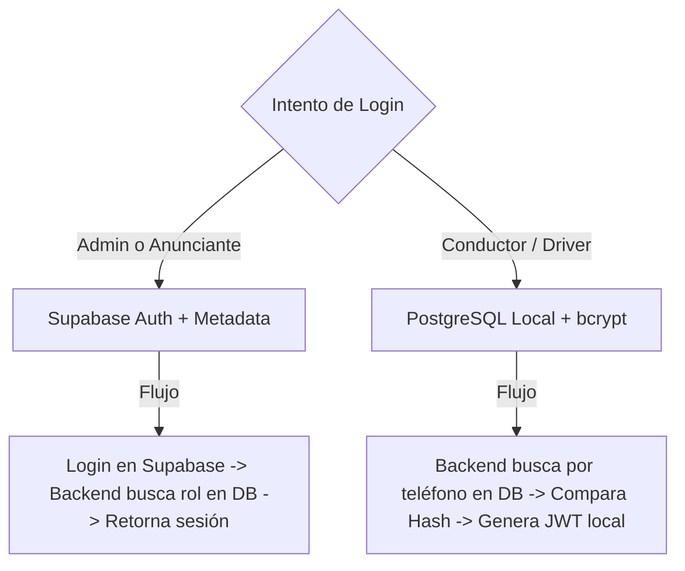

# 🛠️ Desarrollo Local y Resolución de Problemas (Troubleshooting)

Este documento sirve como guía para levantar el entorno de desarrollo de TAD DOOH localmente, entender el flujo de autenticación híbrida y solucionar problemas comunes de ejecución.

---

## 🚀 1. Levantar el Entorno Local

El monorepo cuenta con un script de PowerShell en la raíz llamado `run_all_local.ps1` que levanta todos los microservicios en puertos específicos de forma automática.

### Asignación de Puertos Estándar

| Servicio | URL Local | Descripción |
| :--- | :--- | :--- |
| **NestJS API** | `http://localhost:3000` | Backend Gateway |
| **Admin Portal** | `http://localhost:3001` | Consola de administración general (Next.js) |
| **Advertiser Portal** | `http://localhost:3002` | Panel de anunciantes y BI (Next.js) |
| **Driver Portal** | `http://localhost:3003` | PWA del Chofer (Next.js) |
| **Simulator UI** | `http://localhost:3004` | Generador de telemetría y tráfico GPS virtual |

---

## 🔐 2. Entendiendo la Autenticación Híbrida

Una de las fuentes de confusión más comunes para desarrolladores nuevos es que la plataforma usa **dos sistemas de autenticación completamente aislados**:



### A) Administradores y Anunciantes (Supabase Auth)
* **Cómo funciona:** La autenticación se delega a Supabase. Al loguearse, el backend busca en la base de datos local y le asigna roles (`role: ADMIN` o `role: ADVERTISER`) en los metadatos de Supabase.
* **Problema común:** Si creas un administrador en la tabla `User` de Prisma, pero no existe un usuario correspondiente en Supabase Auth, el login fallará.

### B) Conductores (Base de Datos Local + JWT propio)
* **Cómo funciona:** Los conductores no existen en Supabase Auth. Su inicio de sesión es procesado directamente por el NestJS API (`DriversService.login()`) buscando por el número de teléfono y comparando la contraseña cifrada con `bcrypt`.
* **Problema común:** Al seedear la base de datos local para pruebas (`seed-dev.js`), si el campo de contraseña no está hasheado correctamente o la propiedad `HasPass` es falsa, no podrás entrar con el chofer.

---

## 🛠️ 3. Scripts Utilitarios de Ayuda

Si tienes problemas para acceder a tus portales locales, puedes usar los siguientes scripts en la raíz del proyecto ejecutándolos con `npx tsx [nombre-del-script]`:

### A) Listar Usuarios y Estado de Contraseña
Muestra una lista de todos los usuarios registrados y si tienen sus contraseñas configuradas correctamente en local:
```bash
npx tsx list-users.ts
```

### B) Resetear Contraseña de Admin y Anunciante
Restablece las contraseñas del administrador y del anunciante principal a los valores por defecto de desarrollo:
* **Admin:** `admin@tadtaxi.do` | Contraseña: `TadAdmin2026!`
* **Advertiser:** `marketing1@brand.do` | Contraseña: `Tad2026!`
```bash
npx tsx set-all-pass.ts
```

### C) Asignar Contraseña a un Conductor
Asigna de forma explícita la contraseña de desarrollo al conductor de prueba (`8295550000`):
* **Driver:** Teléfono `8295550000` | Contraseña: `TadDriver2026!`
```bash
npx tsx set-driver-pass.ts
```

---

## 🚨 4. Resolución de Errores Comunes (Troubleshooting)

### A) Error: `EADDRINUSE: address already in use :::3000`
* **Causa:** Quedó un proceso zombie de Node corriendo en segundo plano o el script anterior no se cerró correctamente.
* **Solución (Windows PowerShell):**
  ```powershell
  Get-Process -Id (Get-NetTCPConnection -LocalPort 3000).OwningProcess | Stop-Process -Force
  ```

### B) Error en base de datos: `Relation "XYZ" does not exist`
* **Causa:** Las migraciones de Prisma no se han aplicado al contenedor local o la base de datos de desarrollo.
* **Solución:** Corre las migraciones de Prisma localmente:
  ```bash
  npx prisma db push --schema=packages/database/prisma/schema.prisma
  ```
