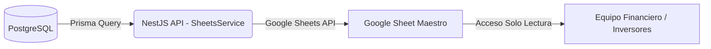

# 📊 Integración con Google Sheets (Sincronización Contable y Operativa)

Este documento detalla la arquitectura, configuración y requisitos operativos para el funcionamiento del módulo `SheetsService` en la API Backend de TAD.

---

## 🏛️ 1. Arquitectura del Flujo

El servicio contable de la plataforma sincroniza periódicamente los datos almacenados en PostgreSQL con un libro de cálculo maestro en Google Sheets. Esto permite que el equipo financiero y administrativo de TAD acceda a reportes contables sin interactuar directamente con la base de datos o el dashboard de administración.



---

## ⚠️ 2. Requisitos Críticos de Pestañas (Estructura Rígida)

El servicio `SheetsService` escribe a pestañas predefinidas en el libro de cálculo utilizando nombres exactos de hoja en español. 

> [!WARNING]
> **Pestaña "Conductores " con espacio final:** El código hace referencia exacta a `sheetsByTitle['Conductores ']`. Si la hoja en tu Google Sheet se llama `Conductores` (sin espacio final), la sincronización fallará arrojando un error en el NestJS API. Asegúrate de incluir el espacio al final del nombre de esta pestaña.

### Relación de Pestañas y Columnas Esperadas

| Nombre de Pestaña (Google Sheet) | Método de Servicio | Tabla Origen (Prisma) | Columnas Inyectadas |
|:---|:---|:---|:---|
| `Conductores ` | `syncConductores()` | `Driver` | `ID_CHOFER`, `NOMBRE_COMPLETO`, `TELEFONO`, `PLACA`, `LICENCIA`, `ESTATUS`, `SUSCRIPCION_PAGA` |
| `Pantallas` | `syncPantallas()` | `Device` | `DEVICE_ID`, `PLACA_ASIGNADA`, `ESTATUS`, `ULTIMA_SEÑAL`, `BATERIA`, `STORAGE_FREE`, `APP_VERSION` |
| `Anunciantes` | `syncAnunciantes()` | `Advertiser` | `ID_ANUNCIANTE`, `NOMBRE`, `RNC`, `TELEFONO`, `NIVEL_ACCESO`, `ESTATUS` |
| `Marcas` | `syncMarcas()` | `Campaign` | `ID_MARCA`, `NOMBRE_COMERCIAL`, `CONTACTO`, `EMAIL`, `PRESUPUESTO_MENSUAL`, `LIMITE_PANTALLAS` |
| `Pagos` | `syncPagos()` | `FinancialTransaction` | `ID`, `FECHA`, `RECEPTOR`, `TIPO_RECEPTOR`, `MONTO_BRUTO`, `NET_AMOUNT`, `TAX_AMOUNT`, `REFERENCIA`, `ESTATUS` |
| `Ingresos` | `syncIngresos()` | `PayrollPayment` | `ID_PAGO`, `CHOFER`, `PLACA`, `MES`, `ANUNCIOS_PLAYBACK`, `ESTATUS_SISTEMA`, `TARIFA_UNITARIA`, `INGRESO_BRUTO`, `FEE_PLATAFORMA`, `TOTAL_PAGAR` |
| `Suscripciones` | `syncSuscripciones()` | `Subscription` | `ID`, `CHOFER`, `PLAN`, `MONTO`, `INICIO`, `VENCIMIENTO`, `PAGADO_EN`, `METODO_PAGO`, `ESTATUS` |
| `Conciliacion` | `syncConciliacion()` | `ReconciliationReport` | `PERIODO`, `ID_CHOFER`, `SUSCRIPCION_ESTATUS`, `SUSCRIPCION_MONTO`, `INGRESOS_REPRODUCCIONES`, `PAGOS_NOMINA_DEBIDO`, `PAGOS_NOMINA_PAGADOS`, `DISCREPANCIA_TOTAL`, `TIPO_DISCREPANCIA` |
| `Estado_Resultados` | `syncEstadoResultados()`| Aggregated calculations | `MES_AÑO`, `INGRESOS_ADS`, `INGRESOS_SUBS`, `TOTAL_INGRESOS`, `COSTO_NOMINA`, `COSTO_HARDWARE`, `GROSS_MARGIN`, `IMPUESTOS_DGII`, `NET_PROFIT` |
| `Cuentas_Por_Cobrar` | `syncCuentasPorCobrar()`| `Subscription` (Pending) | `ID_CLIENTE`, `TIPO_DEUDOR`, `MONTO_ADEUDADO`, `DIAS_ATRASO`, `ESTADO_RIESGO` |

---

## 🔑 3. Configuración y Aprovisionamiento de Credenciales

Para habilitar la conexión de la API con el Google Sheet, debes seguir estos pasos:

### Paso 1: Crear la Service Account en Google Cloud
1. Entra a [Google Cloud Console](https://console.cloud.google.com/).
2. Crea un proyecto nuevo o selecciona uno existente (ej: `TAD Advertising`).
3. Ve a **APIs & Services** > **Library** y activa la **Google Sheets API**.
4. Ve a **IAM & Admin** > **Service Accounts** y haz clic en **Create Service Account**.
5. Ponle un nombre (ej: `tad-sheets-sync`) y haz clic en **Create and Continue**.
6. En la pestaña de la cuenta de servicio creada, haz clic en la pestaña **Keys** > **Add Key** > **Create new key**.
7. Selecciona el formato **JSON** y descárgalo. Guárdalo como `taxi-advertisig-c30861d203c5.json`.

### Paso 2: Compartir el Google Sheet Maestro
1. Abre tu Google Sheet maestro (ID: `1x2PQInj1F5CJnotWVNkCuGEKqULeO9Vv7qkUvmtd-LY`).
2. Haz clic en **Compartir**.
3. Pega el correo de la Service Account que se encuentra en el archivo JSON descargado (ej: `tad-sheets-sync@proyecto.iam.gserviceaccount.com`).
4. Dale permisos de **Editor** y desmarca la opción de enviar notificación. Haz clic en **Compartir**.

### Paso 3: Aprovisionar las Variables en EasyPanel (Producción)
Para no depender de archivos físicos en el servidor de producción (lo cual es una mala práctica), puedes inyectar el JSON de la Service Account en una sola variable de entorno:

1. Codifica el contenido de tu archivo JSON a Base64. Puedes hacerlo en la terminal:
   ```bash
   [Convert]::ToBase64String([System.Text.Encoding]::UTF8.GetBytes((Get-Content taxi-advertisig-c30861d203c5.json -Raw)))
   ```
2. Copia la cadena Base64 generada.
3. Ve a la consola de EasyPanel > Configuración del Servicio `tad-api` > Environment Variables.
4. Registra la siguiente variable:
   * **Nombre:** `GOOGLE_SERVICE_ACCOUNT_JSON_BASE64`
   * **Valor:** *[Tu cadena Base64]*
5. Haz clic en guardar y redespliega.

En desarrollo local, puedes simplemente colocar el archivo `taxi-advertisig-c30861d203c5.json` en la raíz del proyecto para que la API lo lea automáticamente.

---

## 🛠️ 4. Sincronización Manual e Intervalo

* **Endpoint para Sincronización Forzada:** `POST /api/v1/sheets/sync` (Requiere API Key de administrador o sesión de Admin).
* **Mecanismo de Mock:** Si las credenciales no son encontradas o la API de Google Sheets no está disponible, el sistema detectará el error y continuará funcionando en **"Modo Mock"** imprimiendo la advertencia en consola sin tumbar el backend.
