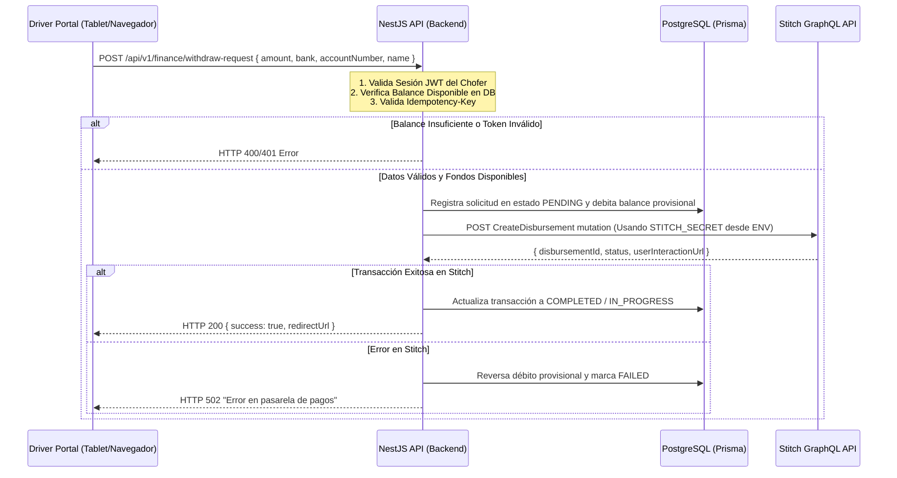

# 🔒 Protocolo de Seguridad e Integración de Stitch Pay

Este documento evalúa el estado de la integración de la pasarela de pagos Stitch Pay para retiros de conductores, identifica una brecha crítica de seguridad y detalla la arquitectura para su mitigación.

---

## 🚨 1. Brecha Crítica de Seguridad: Exposición de API Key en el Cliente

Al auditar la implementación de retiros para conductores en `apps/tablet-player/tad-driver.html`, se encontró el siguiente bloque de código en el lado del cliente (líneas 622-623 y 1069):

```javascript
const STITCH_GQL = 'https://api.stitch.money/graphql';
const STITCH_KEY = 'AQ.Ab8RN6L8TZijndTFsSCcOZy9PrfOHiWU2fAEvtfnQc50enWEfg'; // <-- API KEY EXPUSTA

// Ejecución directa desde el navegador del chofer:
const res = await fetch(STITCH_GQL, {
  method: 'POST',
  headers: {
    'Content-Type': 'application/json',
    'Authorization': `Bearer ${STITCH_KEY}`
  },
  body: JSON.stringify({ query: mutation, variables: vars })
});
```

### 🔴 Impacto y Riesgos
* **Robo de Fondos:** Cualquier usuario que inspeccione el código fuente o intercepte el tráfico de red de la tablet/portal puede extraer la clave secreta `STITCH_KEY` (que posee privilegios de creación de desembolsos/disbursements).
* **Desembolsos Arbitrarios:** Con esta clave, un atacante puede invocar directamente la API GraphQL de Stitch para realizar transferencias de dinero desde la cuenta corriente corporativa de TAD hacia cualquier cuenta de banco, evadiendo completamente los límites de balance proyectado y controles de nómina de TAD.

---

## 🏛️ 2. Arquitectura de Mitigación Propuesta: Backend Proxy Controller

Para resolver de raíz esta vulnerabilidad, la comunicación directa de la tablet con la API de Stitch Money debe **eliminarse por completo** y sustituirse por un flujo seguro a través de la API Backend en NestJS (`apps/api`).

### Diagrama del Flujo Seguro



---

## 🛠️ 3. Pasos para la Implementación Segura

### Paso 1: Mover la clave a Variables de Entorno (.env)
1. Agrega a tu archivo `.env` en la API NestJS:
   ```text
   STITCH_CLIENT_SECRET=AQ.Ab8RN6L8TZijndTFsSCcOZy9PrfOHiWU2fAEvtfnQc50enWEfg
   ```
2. Asegúrate de revocar la clave actual en la consola de Stitch y generar una nueva para evitar que la clave expuesta siga activa.

### Paso 2: Crear el Controller y Service en NestJS (`WalletModule` / `FinanceModule`)
Implementa un endpoint `/finance/withdraw-request` en el backend:

```typescript
// apps/api/src/modules/finance/finance.controller.ts
@Post('withdraw-request')
@UseGuards(JwtAuthGuard)
async requestWithdrawal(
  @Body() dto: WithdrawRequestDto,
  @Request() req
) {
  const driverId = req.user.id; // Obtenido del JWT firmado
  return this.financeService.processDriverWithdrawal(driverId, dto);
}
```

### Paso 3: Consumo en el Frontend (`tad-driver.html`)
Modifica la función `submitWithdraw` en `tad-driver.html` para apuntar únicamente al backend local:

```javascript
async function submitWithdraw() {
  // Validaciones de UI locales...

  const btn = document.getElementById('wd-btn');
  btn.textContent = 'Procesando...'; btn.classList.add('disabled');

  try {
    const r = await fetch(`${API}/finance/withdraw-request`, {
      method: 'POST',
      headers: {
        'Content-Type': 'application/json',
        'Authorization': `Bearer ${JWT}` // Autenticado vía JWT local
      },
      body: JSON.stringify({
        amount,
        bank,
        accountNumber: acct,
        accountHolder: name
      })
    });

    if (!r.ok) throw new Error('Error al procesar el retiro en servidor');
    const json = await r.ok ? await r.json() : null;

    closeWithdraw();
    toast(`✅ Solicitud de retiro registrada de forma segura.`, 'ok');
  } catch (err) {
    toast('Error enviando la solicitud: ' + err.message, 'err');
  } finally {
    btn.textContent = 'Confirmar Retiro'; btn.classList.remove('disabled');
  }
}
```

---

## ⚖️ 4. Reglas de Validación de Retiros en Backend (Anti-Fraude)

* **Tope de Retiro Diario:** Limitar retiros a un máximo de **RD$7,500** por transacción (Toque de la regla de 15 slots).
* **Frecuencia de Retiro:** Permitir un solo retiro cada 24 horas por conductor.
* **Idempotencia:** Exigir cabecera `Idempotency-Key` en la API de NestJS para evitar doble débito por clicks repetidos en el cliente.
* **Verificación de Attendance:** Cruza que el conductor tenga registrado al menos el 75% de Attendance GPS en el período de facturación antes de procesar el retiro.
