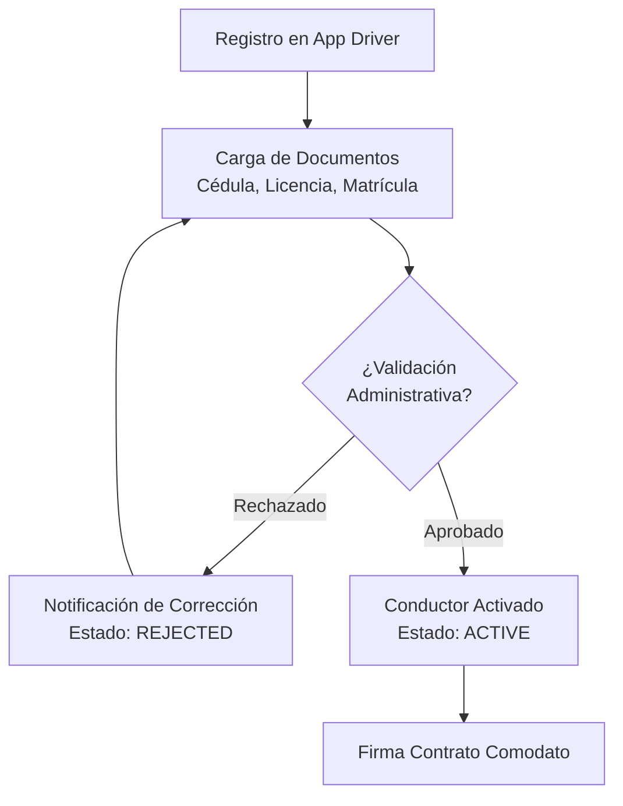

# 🆔 Protocolo de Verificación KYC y Registro de Conductores

Este documento detalla el procedimiento de verificación de identidad (KYC - Know Your Customer) y las reglas de negocio técnicas para el registro de conductores y taxis en la plataforma TAD DOOH.

---

## 🏛️ 1. Flujo del Proceso KYC

Para proteger los activos de la plataforma (tablets en comodato valoradas en RD$6,000) y cumplir con regulaciones locales, todo conductor debe pasar por un proceso de verificación estructurado.

---

## 🗄️ 2. Estructura de Datos en Base de Datos (Prisma)

El modelo `Driver` contiene los campos clave para rastrear el cumplimiento del KYC y evitar duplicados silenciosos en la base de datos:

| Campo Prisma | Tipo | Descripción / Regla de Validación |
| :--- | :--- | :--- |
| `cedula` | `string` (Unique) | Cédula del conductor. Formato normalizado: `XXX-XXXXXXX-X`. |
| `licensePlate` | `string` (Unique) | Placa del vehículo vinculado. Evita que una placa esté asignada a dos choferes. |
| `contractAccepted`| `boolean` | Registra si aceptó los términos legales digitales en la app. |
| `onboardingStatus`| `enum` | `TOS_PENDING`, `PENDING_PAYMENT`, `READY` |
| `status` | `enum` | `PENDING_PAYMENT`, `ACTIVE`, `SUSPENDED` |

---

## 🛡️ 3. Reglas de Validación de Registro (Saneamiento)

Durante el registro del conductor (`DriversService.create()`), el backend realiza saneamiento automático de los datos de entrada para prevenir registros duplicados e inconsistencias:

### A) Cédula Dominicana
* **Limpieza:** Se eliminan guiones y espacios antes de validar o buscar en la base de datos.
* **Fórmula de Luhn (opcional para futura versión):** Permite verificar que el número de cédula sea matemáticamente válido antes de consultar la base de datos.

### B) Placas de Taxi / Vehículo
* **Formato:** Se fuerza la conversión a mayúsculas y eliminación de guiones.
* **Asignación de Dispositivo:** El conductor ingresa la placa de su vehículo y el sistema busca si ya existe una tablet vinculada a esa matrícula en la tabla `Device`.

---

## 📂 4. Carga Segura de Archivos a Supabase Storage

Para almacenar las fotos físicas de los documentos (Cédula de Identidad, Licencia de Conducir y Matrícula del Vehículo):

1. **Bucket Privado:** Los documentos se almacenan en un bucket privado de Supabase llamado `driver-documents`.
2. **Acceso Restringido:** Las imágenes solo son accesibles mediante URLs firmadas generadas por el backend con un TTL de 15 minutos, protegiendo la privacidad de los conductores.
3. **Estructura de Carpetas:**
   * `/driver-documents/[driver-uuid]/cedula_frontal.jpg`
   * `/driver-documents/[driver-uuid]/licencia_frontal.jpg`
   * `/driver-documents/[driver-uuid]/matricula_vehiculo.pdf`

---

## 🤖 5. Roadmap Q2 2026 - Automatización OCR
Como parte de la evolución tecnológica del Sprint 4, se proyecta integrar un microservicio de OCR (ej. Google Cloud Vision) que:
1. Extraiga automáticamente el nombre, número de cédula y fecha de vencimiento de la licencia al subir la foto.
2. Compare el nombre extraído con el ingresado en el formulario.
3. Alerte si la licencia está vencida.
